# DriverApp screen and backend audit — 20 November 2026

[Download the Excel audit](DriverApp_Screen_Runtime_Audit_2026-11-20.xlsx) · [Screen status matrix](#all-planned-screens) · [Findings](#findings) · [Runtime checks](#runtime-checks) · [All screenshots](#all-screenshots)

This is the detailed Markdown companion to the Excel audit. It compares the plan with the checked-out DriverApp and local Docker backend, using synthetic accounts and data. **The full plan is incomplete:** working read/save journeys coexist with integration failures, missing routes and planned features that are not implemented.

| Coverage | Count / meaning |
| --- | --- |
| Plan entries | 191 = 139 current logical screens/states + all 52 older-design references; not 191 unique screens |
| Runtime observations | 96 |
| API checks | 88 |
| Findings | 20 defects, planned gaps and policy-review items; not 20 confirmed crashes |
| Original screenshots | 117 uploaded: 97 Excel-referenced evidence + 20 supplemental/intermediate captures |
| Images embedded inside Excel | 114 images across the Issues and Screenshots sheets; local test credentials redacted for public upload |
| Saved UI actions | 5/5 Mongo persistence assertions passed |
| Known report arithmetic | 17/17 fixture assertions matched |
| Seed snapshot | 307 counted audit records across 58 populated models; excludes users without User.orgId and unloaded models |

## Tested branches and evidence boundaries

| Component | Exact baseline |
| --- | --- |
| DriverApp | release/en-24-nov-driver-app @ 73a415fbc8ef51de02026fecf8f77706e44cef97 |
| Backend | release/en-24-nov-backend @ 77d257c5545e16fd32891543ae5466a1deef85a7 |
| Reference branch | feat/owner-experience-completion is a plan/reference, not the tested checkout |
| Native | iPhone 17, iOS 26.5 Simulator, Expo Go; separate audit Metro on 8082 |
| Backend | Local Docker API and MongoDB; synthetic audit organisations only |
| Report period | 2026-11-19 IST; screenshots taken on 2026-11-20 IST |

Plan inputs were the Kanban [release handoff](https://kanban-olive-seven.vercel.app/#doc/release), backend DRIVER_NAV_MASTER_PLAN_2026-10-28.md, DriverApp DESIGN_IMPLEMENTATION_PLAN.md and the original 52-screen design catalog.

Native and browser observations are labelled separately. The supplemental browser used isolated Chrome with localhost CORS bypass; it received real local API responses and saved real local records. Browser success does not establish unmodified web CORS/deployment compatibility. Diagnostic requests with `X-App-Version: 2.0.0` establish backend behavior only; the unmodified app omits that header and its configured version is 1.0.1.

Only synthetic local data was written. No implementation fixes, production API writes, real external messages or real emergency calls were performed. The audit is not a release sign-off.

## How to read the flags

- **Frontend exists** says whether a component/route exists, including inactive components and placeholders. It does not establish reachability or correctness.
- **Reachable** means there is a normal app entry; a registered route with no menu/trigger is recorded separately.
- **Backend exists** distinguishes a real endpoint/service from a related partial service, a client-only feature or an unverified backend.
- **Backend correctness** states exactly which reads, calculations, writes or contracts were verified.
- **App interactions** separates visible rendering/taps from verified server persistence; an opened screen does not mean every action passed.
- Older-design entries map to related current capabilities only. They are not claimed as separately implemented visual designs. `O10` and `M10` occur in both catalogs; the group/catalog disambiguates them.

## Completion assessment

| Assessment | Plan rows |
| --- | --- |
| FAILED IN TESTED FLOW | 8 |
| INACTIVE | 29 |
| MISSING | 30 |
| PARTIAL | 60 |
| PLACEHOLDER | 10 |
| SOURCE ONLY - NOT RUNTIME VERIFIED | 15 |
| UNREACHABLE | 10 |
| VERIFIED WITHIN TESTED SCOPE | 29 |

## Findings

Each finding below includes its test boundary. Missing-screen findings use the relevant menu/context screenshot; API-only findings have no fabricated screen capture.

### I01 — App/backend version mismatch blocks v2 screens

**BLOCKER · Integration defect** · Plan IDs: `A13 D05 D06 D42 M01 O13`

**Expected:** Compatible requests and actionable update handling

**Observed:** Unmodified app omits X-App-Version. Server assumes 1.0.0 and requires 2.0.0; app config is 1.0.1. Native Manager cards, Driver crew/help and Owner captures show raw 426.

**Reproduce:** Log in as audit Manager -> Home; Driver -> More -> Crew/Driver help; Owner -> Capture reviews.

**Next work:** Agree release version/contract compatibility, send truthful build version and add an update-required state. A header alone with 1.0.1 still fails.

**Evidence:** `logs/api-results.json; logs/postchecks.json; frontend/src/telematics/services/telematicsApi.js`

Show screenshot — 08-issue-manager-426.png

### I02 — Owner review uses the Driver capture endpoint

**HIGH · Integration defect** · Plan IDs: `O13 O14`

**Expected:** Owner queue calls /app/v2/captures/review

**Observed:** Frontend calls /app/v2/captures?page=1. It gets 426 first; diagnostic version 2.0.0 gets 403 for OWNER. Correct /captures/review returns 200.

**Reproduce:** Owner -> More -> Capture reviews.

**Next work:** Use the owner review endpoint and its response schema/pagination; then exercise review decisions.

**Evidence:** `logs/postchecks.json; frontend/src/telematics/services/telematicsApi.js:514`

Show screenshot — 04-issue-owner-capture-queue.png

<a href="screenshots/04-issue-owner-capture-queue.png">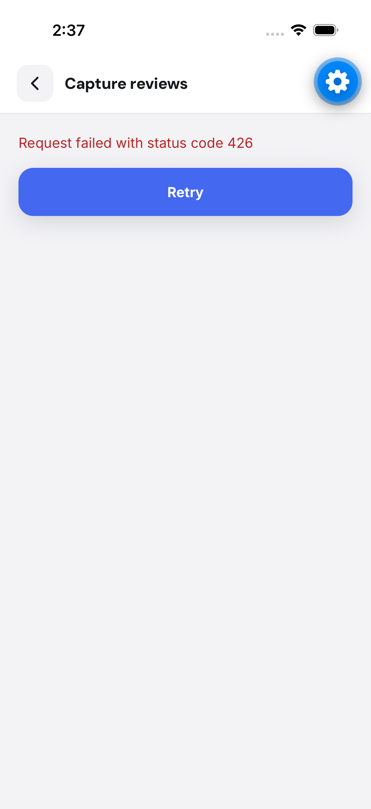</a>

### I03 — Crew URLs, payload and response shapes disagree

**HIGH · Integration defect** · Plan IDs: `D05 M14`

**Expected:** Use /crew, /crew/:vehicleId, /crew/:vehicleId/actions and declared schemas

**Observed:** App uses /crew/me and /crew/vehicles/:id; diagnostic calls give 400/404. expectedVersion and safelyStopped are rejected as extra fields. Detail API returns nested crew/atWheel unlike flat screen assumptions.

**Reproduce:** Driver -> More -> Crew & driving; compare correct diagnostic detail in API evidence.

**Next work:** Align helpers and screen adapters to mounted contracts, then test join/at-wheel/handover/history.

**Evidence:** `logs/api-results.json; logs/postchecks.json; CrewScreens.js; crew.schema.js`

Show screenshot — 14-issue-driver-crew.png

<a href="screenshots/14-issue-driver-crew.png">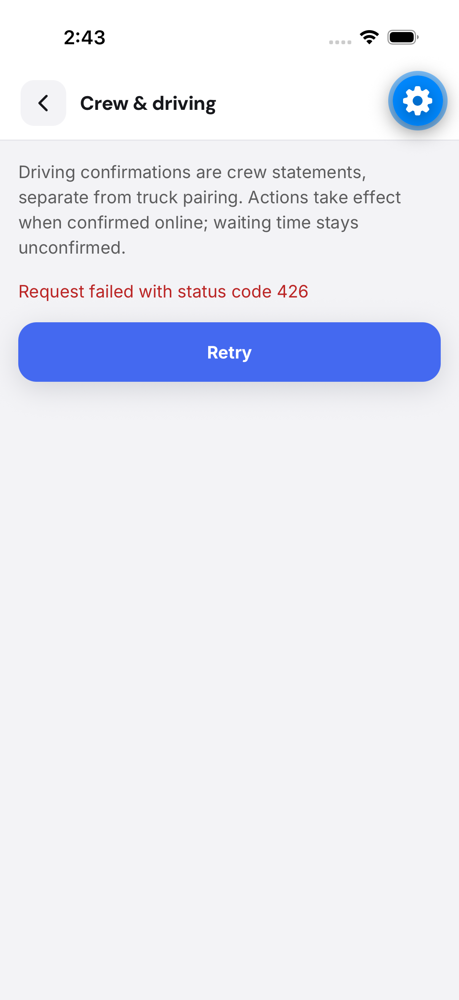</a>

### I04 — Duty response fails its own contract with real intervals

**HIGH · Backend defect** · Plan IDs: `D06 D07`

**Expected:** Duty interval evidence dates serialised as strings/null

**Observed:** Diagnostic 2.0.0 GET /app/v2/duty/today returns 500: evidence.counted[0].start must be string or null. Crew/at-wheel fixtures use real models/services. App first encounters version 426; no normal Rest entry.

**Reproduce:** Use seeded Driver token and X-App-Version:2.0.0 to GET duty/today.

**Next work:** Serialise Date evidence before response validation; verify populated duty and empty states.

**Evidence:** `logs/api-results.json; logs/api-followup.json; app/driverApp/api/routes/duty.controller.js`

No direct UI screenshot: this finding is supported by API/source evidence in the audit.

### I05 — Help response fails contract for alert dates

**HIGH · Backend defect** · Plan IDs: `D41 D42`

**Expected:** Help cards raisedAt serialised as strings/null

**Observed:** Diagnostic 2.0.0 GET /app/v2/help returns 500: cards[0].raisedAt must be string or null. Native screen shows 426 before reaching this defect.

**Reproduce:** Driver -> More -> Driver help; diagnostic API request with version 2.0.0.

**Next work:** Normalise Date fields before response validation and retest real alert cards.

**Evidence:** `logs/api-results.json; logs/api-followup.json`

Show screenshot — 18-driver-help.png

<a href="screenshots/18-driver-help.png">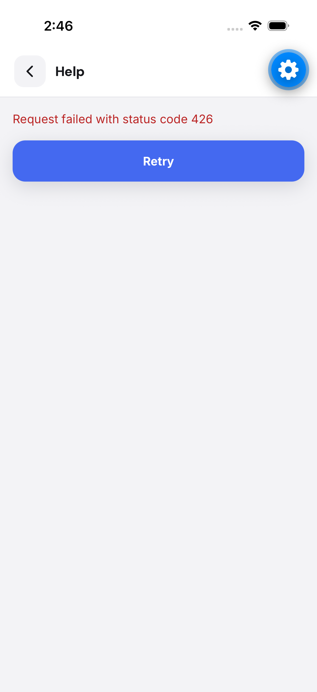</a>

### I06 — Field Agent organisation selector crashes on load

**BLOCKER · Frontend defect** · Plan IDs: `F02`

**Expected:** Loading state handles null data and then lists memberships

**Observed:** Native Orgs tab renders Cannot read property length of null. useApi initially returns data:null; FieldAgentOrgsScreen reads orgs.length before guarding it.

**Reproduce:** Use multi-org agent@... -> Orgs. Backend /me/orgs returns two active memberships.

**Next work:** Guard initial/error data as an array and retest first load, retry and org switching.

**Evidence:** `logs/native-agent-crash-hierarchy.txt; frontend/src/hooks/useApi.js; FieldAgentOrgsScreen.js`

Show screenshot — 26-issue-agent-org-crash.png

<a href="screenshots/26-issue-agent-org-crash.png">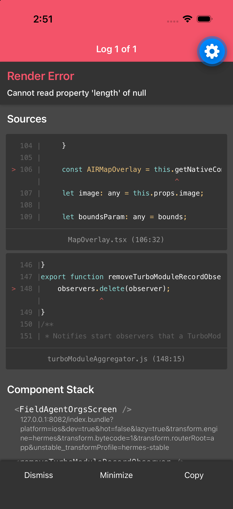</a>

### I07 — Field Agent server logout is not revoked

**HIGH · Integration defect** · Plan IDs: `F07 A14`

**Expected:** Logout retains required org context until server session is revoked

**Observed:** Native POST /app/v1/auth/logout returns 400: X-Org-Id header is required for Field Agents. Local identity is cleared; server revocation fails. Dev console error can obscure the next login.

**Reproduce:** Field Agent -> Profile -> Log out.

**Next work:** Pass captured active org into revokeAppSession; preserve local sign-out if network revocation fails.

**Evidence:** `frontend/src/context/AuthContext.js:149; frontend/src/services/api.js:169`

Show screenshot — 32-issue-agent-logout-org-header.png

<a href="screenshots/32-issue-agent-logout-org-header.png">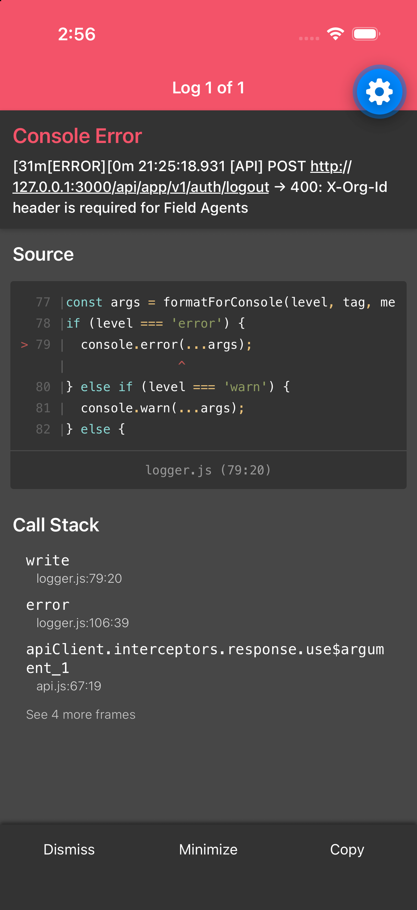</a>

### I08 — Chosen truck is dropped by the fuel form

**MEDIUM · Frontend defect** · Plan IDs: `F03 F04`

**Expected:** AUD20NOV01 selected in picker remains selected in form

**Observed:** Picker passes vehicleId/vehicleNumber to FuelCapture. Registered FuelLogFormScreen ignores route params and initialises vehicleId empty; native form shows Vehicle:Choose.

**Reproduce:** Single-org agent.primary@... -> Upload fuel receipt -> Select AUD20NOV01.

**Next work:** Initialise and validate the chosen truck against current-org options; load its driver and previous reading.

**Evidence:** `frontend/src/screens/driver/fuel/FieldAgentVehiclePickerScreen.js; FuelLogFormScreen.js:69`

Show screenshot — 34-issue-agent-selected-truck-lost.png

<a href="screenshots/34-issue-agent-selected-truck-lost.png">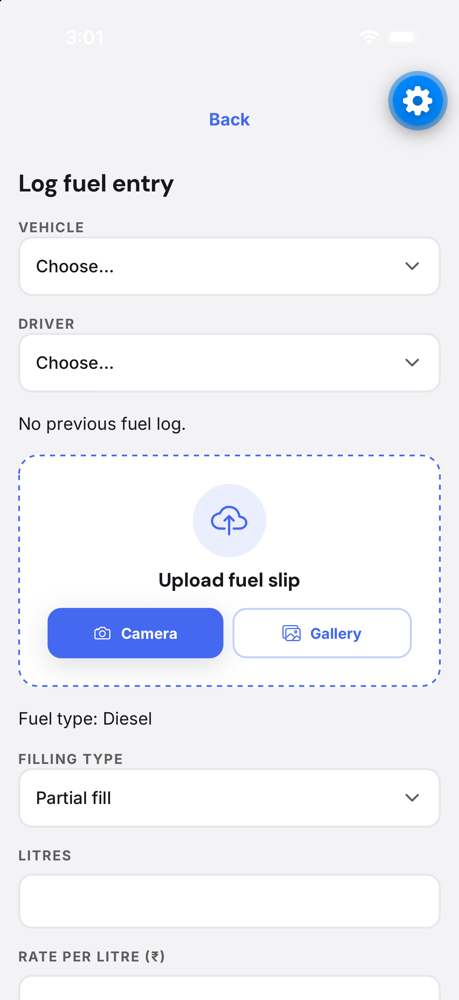</a>

### I09 — Fuel log makes hard-coded period/trend claims

**MEDIUM · Frontend defect** · Plan IDs: `F05 20`

**Expected:** Month and trend reflect loaded records or unknown

**Observed:** Native log shows August and Improving in November, including an empty organisation with no mileage data. Source literals confirm this is not computed.

**Reproduce:** Field Agent -> Fuel; inspect empty-org log screenshot.

**Next work:** Use actual date/filter and measured trend, or show unknown when no usable history.

**Evidence:** `frontend/src/screens/driver/fuel/FuelLogScreen.js:84`

Show screenshot — 27-agent-fuel-history.png

<a href="screenshots/27-agent-fuel-history.png">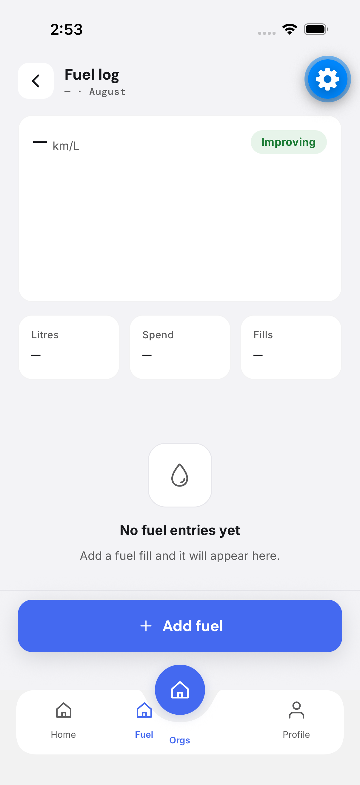</a>

### I10 — Navigate and driving journey are not implemented

**HIGH · Planned gap - Phase 2** · Plan IDs: `N01 N02 N03 N04 N05 N06 N07 N08 N09 N10 N11`

**Expected:** Planned map/search/preview/guidance/offline states

**Observed:** Driver Navigate is an unavailable page. Backend navigation, destinations, routes and ahead contracts do not produce an active frontend journey.

**Reproduce:** Driver default Navigate tab.

**Next work:** Complete Phase 2 frontend and custom native/device integration; keep separate from Phase 1 release acceptance.

**Evidence:** `DriverNavigator.js; experience/DriverNavigation.js; backend-contracts.json`

Show screenshot — 21-issue-navigation-unavailable.png

<a href="screenshots/21-issue-navigation-unavailable.png">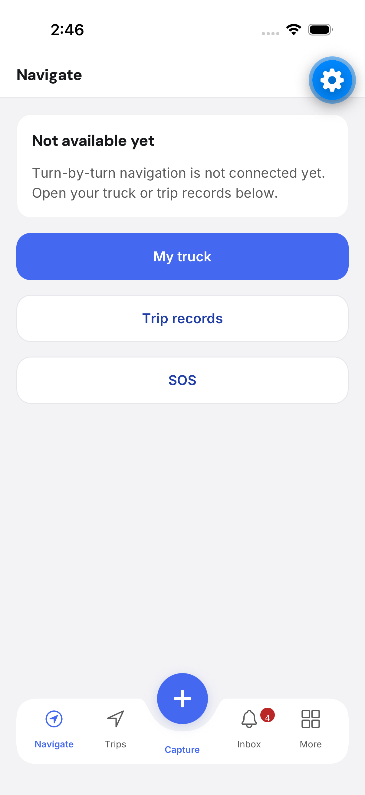</a>

### I11 — Wallet, reimbursement and advances are inactive

**HIGH · Planned gap - older design** · Plan IDs: `D18 D19 D20 D21`

**Expected:** Accessible wallet/bills/ledger/advance flows

**Observed:** Older components and backend bills/advance services exist, but active Driver shell has no Wallet/Add bill/My advances route. Advance-request action is not connected.

**Reproduce:** Inspect Driver More and Capture menus; compare route inventory with original design.

**Next work:** Decide retained scope; connect required flows and test balances, rejection, resubmission and payouts.

**Evidence:** `driverapp-active-route-inventory-2026-11-20.json; DESIGN_IMPLEMENTATION_PLAN.md`

Show screenshot — 22-driver-capture-menu.png

<a href="screenshots/22-driver-capture-menu.png">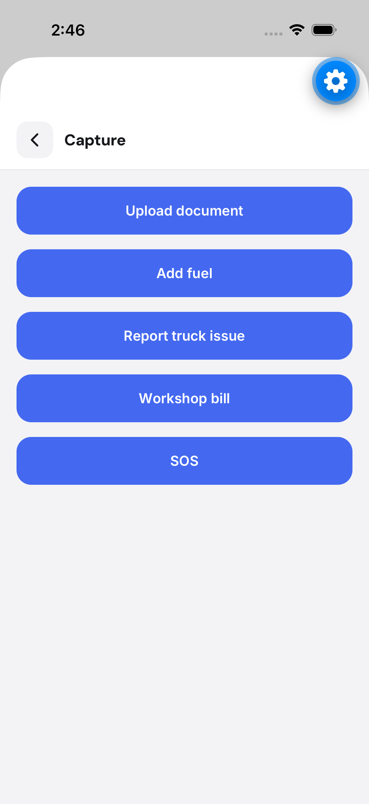</a>

### I12 — Manager action details do not implement planned actions

**HIGH · Planned gap** · Plan IDs: `M02 M03 M17`

**Expected:** Call/outcome, handled, snooze, escalate and feedback UI

**Observed:** Backend supports card actions, but current detail screen renders evidence rather than complete action controls; Home also blocked by I01.

**Reproduce:** Inspect ManagerActions.js ActionDetail and registered routes; Home runtime is blocked.

**Next work:** Wire actions and idempotent outcomes to contracts after version integration.

**Evidence:** `frontend/src/telematics/experience/ManagerActions.js; backend-contracts.json`

Show screenshot — 08-issue-manager-426.png

### I13 — Registered services lack normal menu paths

**HIGH · Reachability gap** · Plan IDs: `A08 D06 D16 D29 D32 D33 D41`

**Expected:** Driver can reach consent, rest, road/site/question workflows

**Observed:** Routes exist but primary More/Capture menus do not expose privacy consent, Rest & hours, Road report, Site card, reminders and Helpful cards. Stop reasons sits behind secondary Quick add, absent from primary Capture.

**Reproduce:** Review visible Driver More/Capture entries and active route inventory.

**Next work:** Add intentional entries/triggers and retest actual entry, permission and save flows.

**Evidence:** `DriverNavigator.js; experience/routes.js; DriverScreens.js`

Show screenshot — 22-driver-capture-menu.png

### I14 — Owner promise, trip-cost closure and declaration-policy screens absent

**HIGH · Planned gap** · Plan IDs: `O15 O16 O17 O18`

**Expected:** Owner can set promise, inspect cost closure, declare crew/policy

**Observed:** Corresponding backend readers/services exist; current Owner branch lacks the planned screens/forms. Crew & driving is vehicle crew, not owner declarations/policy.

**Reproduce:** Compare Owner menu and branch routes with master/owner plans.

**Next work:** Implement accepted frontend scope then test revisions, validation and persistence.

**Evidence:** `owner-experience-remaining-work-2026-10-29.md; OwnerNavigator.js`

Show screenshot — 03-owner-more.png

<a href="screenshots/03-owner-more.png">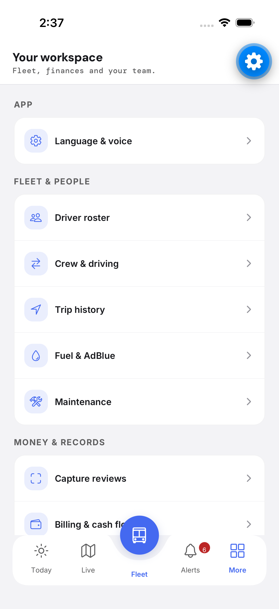</a>

### I15 — Legacy report entry has no visible exit

**MEDIUM · Frontend navigation gap** · Plan IDs: `O01`

**Expected:** A report opened from More has a back control

**Observed:** More -> Today's business report opens a full report with no visible back button and no bottom tab bar. Browser tour cannot return via the normal header. iOS edge-back escape was not verified.

**Reproduce:** Owner -> More -> Today's business report.

**Next work:** Render a back control for this stack route or route to the Today tab; test iOS and web.

**Evidence:** `OwnerScreens.js OwnerDailyReport alias; OwnerReportScreens.js`

Show screenshot — web-owner-today-s-business-report.png

<a href="screenshots/web-owner-today-s-business-report.png">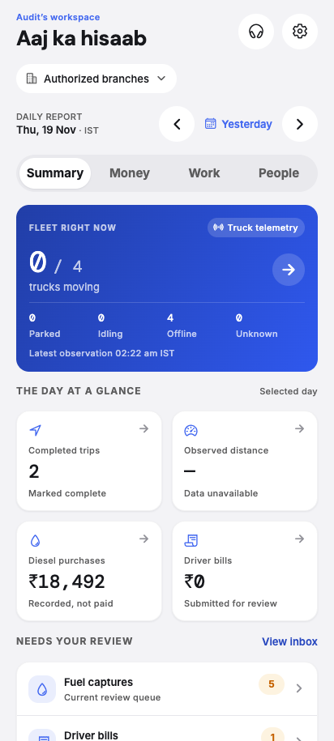</a>

### I16 — Data saver, simple mode and survey preferences missing

**MEDIUM · Planned gap** · Plan IDs: `A11`

**Expected:** Requested controls and actual behavioral effects

**Observed:** Language/voice settings contains three language buttons, voice test and battery help only. No active controls for data saver, simple mode or survey preference.

**Reproduce:** More -> Language & voice / Experience settings.

**Next work:** Define and implement preference storage plus corresponding behavior before marking complete.

**Evidence:** `frontend/src/telematics/experience/ExperienceExtras.js`

Show screenshot — web-owner-language-voice.png

### I17 — Manager branch daily report absent

**HIGH · Plan/role gap** · Plan IDs: `M15`

**Expected:** Branch manager can open planned branch report

**Observed:** No Manager report screen; Owner daily API returns 403 to Manager by current role rule. This is expected API enforcement but missing planned capability.

**Reproduce:** Use Manager token GET /app/v2/reports/daily; inspect Manager menu.

**Next work:** Agree Manager-specific scope/contract and implement report UI. Do not simply remove Owner authorisation.

**Evidence:** `logs/api-results.json; ManagerNavigator.js`

Show screenshot — web-manager-tab-more.png

<a href="screenshots/web-manager-tab-more.png">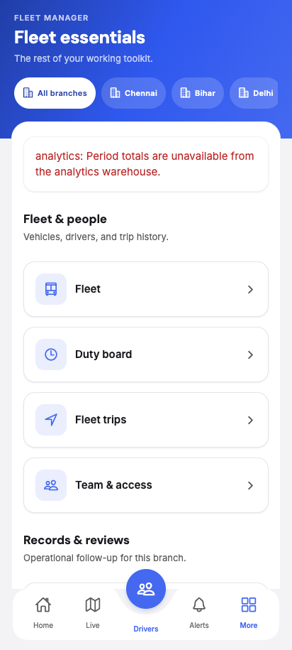</a>

### I18 — Capture read scope declaration differs from org-wide implementation

**REVIEW · Contract/policy discrepancy** · Plan IDs: `D14 O14`

**Expected:** Explicit agreement whether captures are driver-self or shared within org

**Observed:** With diagnostic version 2.0.0, Driver 1 reads own and co-driver capture metadata (both 200). Contracts declare scope.driver:self while descriptions/use case read org-wide. Cross-org list remains isolated.

**Reproduce:** GET seeded capture0 and capture1 with Driver 1; compare declared scope and API descriptions.

**Next work:** Resolve ownership policy; if self is intended, enforce it in list/by-id. This audit does not call it a confirmed cross-tenant leak.

**Evidence:** `logs/postchecks.json; captureList.contract.js; captureById.contract.js`

No direct UI screenshot: this finding is supported by API/source evidence in the audit.

### I19 — Report delivery/audience/provider settings incomplete

**MEDIUM · Planned gap** · Plan IDs: `O08 O09 C08 C10`

**Expected:** Email/WhatsApp controls, delivery history and complete audiences

**Observed:** Current UI saves enabled/time/language/branch. Email/WhatsApp settings, provider delivery history and full audience controls are absent/partial; external sending not tested.

**Reproduce:** Owner -> Morning report; compare delivery-history API and menu.

**Next work:** Complete accepted settings and outcome UI, then test delivery on approved external test channels.

**Evidence:** `OwnerReportScreens.js ReportSettings; ownerExperience.routes.js`

Show screenshot — web-owner-morning-report.png

<a href="screenshots/web-owner-morning-report.png">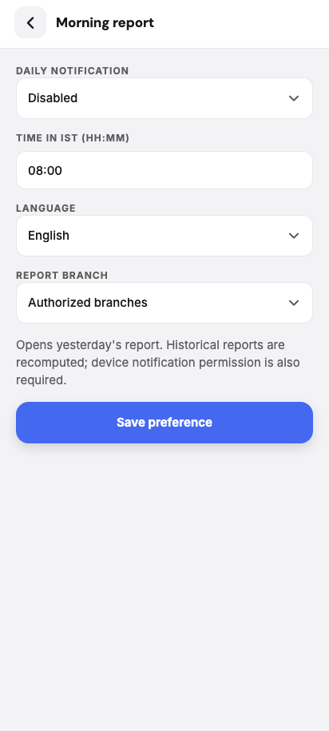</a>

### I20 — Required idempotency headers missing on v2 writes

**HIGH · Integration defect** · Plan IDs: `A08 D05 D14 D31`

**Expected:** Retry-safe writes carry stable Idempotency-Key

**Observed:** Client has no Idempotency-Key handling for consent/crew/capture/prompt APIs. Consent POST returns 400 without it even though its min version is 1.0.0; correct crew action also returns 400 without it with diagnostic version.

**Reproduce:** Run logged postchecks or invoke the currently unreachable consent action from its source path.

**Next work:** Create and persist a stable header key per submission, handle conflicts and retest retries without duplicate writes.

**Evidence:** `logs/postchecks.json; frontend/src/telematics/services/telematicsApi.js; app/driverApp/api/router.js:409`

No direct UI screenshot: this finding is supported by API/source evidence in the audit.

## All planned screens

The following tables retain all 191 entries and the separate frontend/backend flags from Excel. Full endpoints, entry paths, remaining work and source references are also available in [screen-matrix.csv](evidence/screen-matrix.csv) and [screen-matrix.json](evidence/screen-matrix.json).

### Shared entry, permissions and settings

| ID | Planned screen / state | Completion | Frontend exists | Reachable | Backend exists | Backend correctness | App interactions | Explanation / remaining work |
| --- | --- | --- | --- | --- | --- | --- | --- | --- |
| A01 | Welcome / value introduction | SOURCE ONLY - NOT RUNTIME VERIFIED | YES | YES | N/A | NOT APPLICABLE | NOT TESTED | Brand/value introduction exists; this is the current onboarding, not the older five-screen sequence. |
| A02 | Language selection | PARTIAL | YES | YES | N/A | NOT APPLICABLE | OPENED - deeper behavior unverified | en/hi/bn selection exists. Full translated screens, spoken confirmation and language/device review remain. [Screenshot](screenshots/web-owner-language-voice.png) |
| A03 | Password sign-in | SOURCE ONLY - NOT RUNTIME VERIFIED | YES | YES | YES | NOT FULLY VERIFIED - see evidence/notes | NOT TESTED | Visible submit/loading/error flow exists. Session refresh and offline recovery are separate gaps. |
| A04 | Phone + OTP verification | MISSING | NO | NO - not implemented | YES | NOT FULLY VERIFIED - see evidence/notes | NO IMPLEMENTATION TO TEST | Current Login offers password only; add the visible OTP journey if still required by product. |
| A05 | Set PIN / unlock / wallet gate | MISSING | NO | NO - not implemented | NOT FOUND | NOT FULLY VERIFIED - see evidence/notes | NO IMPLEMENTATION TO TEST | PIN setup, secure storage, unlock and wallet gate are absent from the active flow. |
| A06 | Forgot password | PARTIAL | YES | YES | UNVERIFIED | NOT FULLY VERIFIED - see evidence/notes | NOT TESTED | Dialog asks the user to contact manager/support; no self-service reset form. |
| A07 | Location permission / sharing | PARTIAL | YES | YES | YES | READ/API EVIDENCE AVAILABLE - full mutation and edge-state correctness unverified | OPENED - deeper behavior unverified | No navigation-triggered staged onboarding yet; duty/consent/refresh eligibility and recovery are unfinished. [Screenshot](screenshots/web-driver-location-sharing.png) |
| A08 | Privacy and consent | UNREACHABLE | YES | NO - route only | YES | PARTIAL - API exists; version/path/retry contract integration failing | NOT TESTED | Notice/grant/withdraw UI exists; no normal settings/menu link found. Writes omit required retry header; withdrawal does not directly stop all sampling. |
| A09 | Battery help | PARTIAL | YES | YES | N/A | NOT APPLICABLE | NOT TESTED | Generic instructions and OS-settings button exist; phone-brand detection, screenshots and tracking-gap recovery are absent. |
| A10 | Language and voice settings | PARTIAL | YES | YES | N/A | NOT APPLICABLE | OPENED - deeper behavior unverified | Language and test phrase exist; speaker/voice choice, rate controls and full preference UI are incomplete. [Screenshot](screenshots/web-owner-language-voice.png) |
| A11 | Data saver / simple mode / survey settings | MISSING | NO | NO - not implemented | N/A | NOT APPLICABLE | NO IMPLEMENTATION TO TEST | Add controls and behavior; map orientation belongs with navigation. |
| A12 | Push permission / registration settings | VERIFIED WITHIN TESTED SCOPE | YES | YES | YES | READ/API EVIDENCE AVAILABLE - full mutation and edge-state correctness unverified | LIMITATION - simulator/native push unavailable; OPENED - deeper behavior unverified | UI and registration controls exist; physical-device permission/receipt acceptance remains. [Screenshot](screenshots/web-owner-settings-support.png) |
| A13 | Update-required screen | MISSING | NO | NO - not implemented | YES | NOT FULLY VERIFIED - see evidence/notes | NO IMPLEMENTATION TO TEST | Actual binary/version compatibility and an actionable update screen are required. |
| A14 | Session reconnect / expired-offline recovery | PARTIAL | YES | YES | YES | NOT FULLY VERIFIED - see evidence/notes | NOT TESTED | Rotated credentials, coordinated foreground/background refresh and explicit recovery remain. |
| A15 | Startup loading / unsupported role | SOURCE ONLY - NOT RUNTIME VERIFIED | YES | YES | N/A | NOT APPLICABLE | NOT TESTED | These are actual app states retained outside the numbered visual catalog; not additional business features. |

### Driver operational screens

| ID | Planned screen / state | Completion | Frontend exists | Reachable | Backend exists | Backend correctness | App interactions | Explanation / remaining work |
| --- | --- | --- | --- | --- | --- | --- | --- | --- |
| D01 | Driver shell | PARTIAL | YES | YES | YES | READ/API EVIDENCE AVAILABLE - full mutation and edge-state correctness unverified | PLACEHOLDER - navigation unavailable | Shell shape exists. Navigate is an unavailable page; several planned services have no normal entry. [Screenshot](screenshots/web-driver-initial.png) |
| D02 | Operational Home / on-duty / off-duty states | UNREACHABLE | YES | NO - retained Home route, no ordinary menu entry | YES | NOT FULLY VERIFIED - see evidence/notes | NOT TESTED | Shows truck, crew and recent trips. Older wallet hero, eight-stage active-trip and complete on/off-duty designs are not implemented here. |
| D03 | My truck | FAILED IN TESTED FLOW | YES | YES | YES | READ/API EVIDENCE AVAILABLE - full mutation and edge-state correctness unverified | FAIL - HTTP 426 | Truck/odometer/location and crew link exist; full planned papers/service/wallet summary is not present. [Screenshot](screenshots/web-driver-my-truck.png) |
| D04 | Choose / change truck | SOURCE ONLY - NOT RUNTIME VERIFIED | YES | YES | YES | NOT FULLY VERIFIED - see evidence/notes | NOT TESTED | Nearby selection and explicit confirmation exist; device GPS/permission/conflict acceptance remains. |
| D05 | My crew / handover / history | FAILED IN TESTED FLOW | YES | YES | YES | PARTIAL - API exists; version/path/retry contract integration failing | FAIL - HTTP 426 | UI, invitation, safety confirmation and handover/history exist; current backend URLs, payload and response differ. Two-phone prompts remain. [Screenshot](screenshots/web-driver-crew-driving.png) |
| D06 | Rest &amp; hours | UNREACHABLE | YES | NO - route only | YES | FAIL - populated diagnostic response contract (HTTP 500); app first blocked by 426 | NOT TESTED | Read-only duty display exists; no normal menu link found; v2 version gate blocks the current caller. |
| D07 | Break planner | MISSING | NO | NO - not implemented | YES | FAIL - populated diagnostic response contract (HTTP 500); app first blocked by 426 | NO IMPLEMENTATION TO TEST | No break-plan result screen or integrated next-rest choices. |
| D08 | Recorded trips list | VERIFIED WITHIN TESTED SCOPE | YES | YES | YES | READ/API EVIDENCE AVAILABLE - full mutation and edge-state correctness unverified | OPENED - deeper behavior unverified; PASS - seeded journeys visible | Paginated GPS-trip cards exist; this is distinct from ERP job stages and earnings. [Screenshot](screenshots/web-driver-tab-trips.png) |
| D09 | Recorded trip detail / route / stops | VERIFIED WITHIN TESTED SCOPE | YES | YES | YES | READ/API EVIDENCE AVAILABLE - full mutation and edge-state correctness unverified | PASS - seeded trip/fuel detail visible | Recorded route, stops, fuel link and optional ERP link exist. Full per-crew financial journey summary is separate. [Screenshot](screenshots/15-driver-trip-detail.png) |
| D10 | ERP trips list | VERIFIED WITHIN TESTED SCOPE | YES | YES | YES | READ/API EVIDENCE AVAILABLE - full mutation and edge-state correctness unverified | OPENED - deeper behavior unverified | Paginated ERP trips and document-detail entry exist. [Screenshot](screenshots/web-driver-erp-trips.png) |
| D11 | Consignment note / POD upload | PARTIAL | YES | YES | YES | NOT FULLY VERIFIED - see evidence/notes | NOT TESTED | Stores an attachment. Does not implement planned multi-page CN quality/stage unlock or POD-driven trip closure and earning release. |
| D12 | Post-trip journey summary | PLACEHOLDER | YES | YES | PARTIAL | NOT FULLY VERIFIED - see evidence/notes | NOT TESTED | Per-crew hours, uncertain intervals, lane comparison, paper/money status and positive summary remain missing. |
| D13 | Capture action sheet | PARTIAL | YES | YES | N/A | NOT APPLICABLE | PARTIAL - working menu; planned tools missing | Menu exists; camera-first default, Road Report entry and motion-based locking/reminders are missing. [Screenshot](screenshots/22-driver-capture-menu.png) |
| D14 | Photo-any-paper / universal capture | PARTIAL | YES | YES | YES | PARTIAL - API exists; version/path/retry contract integration failing | OPENED - deeper behavior unverified | Basic stored upload exists. V2 intake, multiple pages, retake, original fingerprint and full review lifecycle are incomplete; alias has no normal menu link. [Screenshot](screenshots/web-driver-add-document-form.png) |
| D15 | My papers / document list and detail | PARTIAL | YES | YES | YES | READ/API EVIDENCE AVAILABLE - full mutation and edge-state correctness unverified | OPENED - deeper behavior unverified; PASS - two personal records visible | Files, expiry and saved/verified state exist. Received/read/approved/rejected/paid lifecycle is not implemented by this document list. [Screenshot](screenshots/web-driver-documents.png) |
| D16 | Document reminders / renew / retake | UNREACHABLE | YES | NO - route only | YES | NOT FULLY VERIFIED - see evidence/notes | NOT TESTED | No normal entry to the alias found; dedicated reminder list, correct-record actions and retake decision lifecycle remain. |
| D17 | DigiLocker verification | INACTIVE | YES | NO - inactive component | YES | NOT FULLY VERIFIED - see evidence/notes | NOT TESTED | Active Documents uses OperationalScreens and does not mount that card. |
| D18 | Wallet: bills / ledger / empty state | INACTIVE | YES | NO - inactive component | YES | NOT FULLY VERIFIED - see evidence/notes | NOT TESTED | Register and integrate; verify balances, rows, retry and payment semantics. Papers &amp; money is only a document-list alias. |
| D19 | Add reimbursement bill / resubmit | INACTIVE | YES | NO - inactive component | YES | NOT FULLY VERIFIED - see evidence/notes | NOT TESTED | Wire from Capture/More/Wallet; complete persistent retry, trip/date and rejection/resubmit lifecycle. |
| D20 | Bill sent / pending confirmation | INACTIVE | YES | NO - inactive component | YES | NOT FULLY VERIFIED - see evidence/notes | NOT TESTED | Wire from the active bill form; retain pending versus paid distinction. |
| D21 | My advances / request advance | INACTIVE | YES | NO - inactive component | YES | NOT FULLY VERIFIED - see evidence/notes | NOT TESTED | Wire list and detail; its Request an advance button currently has an empty handler. |
| D22 | Fuel capture / OCR / details / saved | PARTIAL | YES | YES | YES | READ/API EVIDENCE AVAILABLE - full mutation and edge-state correctness unverified | OPENED - deeper behavior unverified | Real receipt/odometer/form workflow exists. Older three-photo flow, pocket-paid reimbursement and wallet projection are not complete. [Screenshot](screenshots/web-driver-add-fuel-form.png) |
| D23 | Fuel history / record evidence | VERIFIED WITHIN TESTED SCOPE | YES | YES | YES | READ/API EVIDENCE AVAILABLE - full mutation and edge-state correctness unverified | OPENED - deeper behavior unverified | Paginated records and receipt evidence exist; planned wallet confirmation/mileage chart experience is separate. [Screenshot](screenshots/web-driver-fuel-history.png) |
| D24 | Workshop bill upload / OCR / history | PARTIAL | YES | YES | YES | READ/API EVIDENCE AVAILABLE - full mutation and edge-state correctness unverified | OPENED - deeper behavior unverified | Maintenance evidence upload and extracted fields exist; this is not reimbursement approval/payment or the full older parts/labour repair editor. [Screenshot](screenshots/web-driver-workshop-bills.png) |
| D25 | Truck issue / incident list and detail | VERIFIED WITHIN TESTED SCOPE | YES | YES | YES | PASS FOR TESTED READ/SAVE - reconciliation or Mongo persistence verified; broader lifecycle untested | OPENED - deeper behavior unverified; PASS - UI write and Mongo persistence verified | Issue submission, history and dispatch/resolution evidence exist. Planned voice/movement-safe capture is broader. [Screenshot](screenshots/web-driver-my-issues.png) |
| D26 | Support ticket / conversation / reply | VERIFIED WITHIN TESTED SCOPE | YES | YES | YES | PASS FOR TESTED READ/SAVE - reconciliation or Mongo persistence verified; broader lifecycle untested | OPENED - deeper behavior unverified; PASS - UI write and Mongo persistence verified | Connected persisted support workflow exists; distinct from team messaging. [Screenshot](screenshots/web-driver-support.png) |
| D27 | Inbox / unread badge | PARTIAL | YES | YES | YES | READ/API EVIDENCE AVAILABLE - full mutation and edge-state correctness unverified | OPENED - deeper behavior unverified; PASS - seeded alerts/unread visible | Alert list/unread/ack exists. Owner messages are a separate Messages view; queued questions and full expiry/financial actions are not unified here. [Screenshot](screenshots/web-driver-tab-inbox.png) |
| D28 | Alert detail / acknowledgement | SOURCE ONLY - NOT RUNTIME VERIFIED | YES | YES | YES | NOT FULLY VERIFIED - see evidence/notes | NOT TESTED | Detail and acknowledgement exist; crew notifications lead to the currently incompatible crew reader. |
| D29 | Road-report form | UNREACHABLE | YES | NO - route only | YES | NOT FULLY VERIFIED - see evidence/notes | NOT TESTED | Report buttons exist, but no normal Capture/menu entry found. Current version gate and fresh-ID-per-attempt retry remain. |
| D30 | Nearby hazards / still-there report | MISSING | NO | NO - not implemented | YES | NOT FULLY VERIFIED - see evidence/notes | NO IMPLEMENTATION TO TEST | Add authorized nearby list, confirmation and expired-report state. |
| D31 | Shared yes/no question chip / queued prompts | MISSING | NO | NO - not implemented | YES | PARTIAL - API exists; version/path/retry contract integration failing | NO IMPLEMENTATION TO TEST | No shared host with ten-second fade, dismissal/timeout, safe motion recipient gating or stopped-inbox answers. |
| D32 | Manual stop explanation | UNREACHABLE | YES | NO - route only | YES | NOT FULLY VERIFIED - see evidence/notes | NOT TESTED | Reader/form/save exist. Active Capture does not expose this Quick add menu; add normal access. Automated questions remain separate. |
| D33 | Plant / gate Site Card | UNREACHABLE | YES | NO - route only | YES | NOT FULLY VERIFIED - see evidence/notes | NOT TESTED | Visit/site reader displays queue/gates/papers. No normal entry or plant push tap route found; waiting/loading and exit-POD actions incomplete. |
| D34 | SOS choice / send / saved status | SOURCE ONLY - NOT RUNTIME VERIFIED | YES | YES | YES | NOT FULLY VERIFIED - see evidence/notes | NOT TESTED | Incident, persisted retry and delivery-status UI exist. Real dispatch/ack/mechanic assignment require evidence; current UI correctly qualifies push status. |
| D35 | Driver profile | PARTIAL | YES | YES | N/A | NOT APPLICABLE | OPENED - deeper behavior unverified | Identity, local nickname, push settings and logout exist. Planned wallet/advance grouped profile and actionable language row are incomplete; language works in Experience settings. [Screenshot](screenshots/web-driver-profile.png) |
| D36 | More / tools menu | PARTIAL | YES | YES | N/A | NOT APPLICABLE | OPENED - deeper behavior unverified; PARTIAL - working menu; planned tools missing | Operational links exist. Wallet, rest, privacy, nearby reports and several registered services are not in the normal menu. [Screenshot](screenshots/web-driver-tab-more.png) |
| D37 | Pre-trip inspection | PLACEHOLDER | YES | YES | PARTIAL | NOT FULLY VERIFIED - see evidence/notes | NOT TESTED | Inspection form, result and persistence not implemented. |
| D38 | Standalone delivery confirmation | PLACEHOLDER | YES | YES | PARTIAL | NOT FULLY VERIFIED - see evidence/notes | NOT TESTED | Dedicated confirmation flow absent. ERP attachment upload is available separately. |
| D39 | Standalone Add expense | PLACEHOLDER | YES | YES | PARTIAL | NOT FULLY VERIFIED - see evidence/notes | NOT TESTED | Generic expense form absent; inactive AddBill is the reimbursement reference. |
| D40 | My earnings | PLACEHOLDER | YES | YES | PARTIAL | NOT FULLY VERIFIED - see evidence/notes | NOT TESTED | No earning calculation/detail/settlement screen; do not infer earnings from capture or GPS trip data. |
| D41 | Driver helpful cards / right of reply | UNREACHABLE | YES | NO - route only | YES | FAIL - populated diagnostic response contract (HTTP 500); app first blocked by 426 | NOT TESTED | Separate view has no normal incoming entry found. Reply button opens generic Messages instead of preserving the manager card identity. |
| D42 | Driver Help / contact office / breakdown help | FAILED IN TESTED FLOW | YES | YES | YES | FAIL - populated diagnostic response contract (HTTP 500); app first blocked by 426 | FAIL - HTTP 426 | Help buttons/API and breakdown result exist; version gate blocks current v2 caller. No complete short-video library or future Ask Sahayak assistant; helpful-card reply remains incomplete. [Screenshot](screenshots/web-driver-driver-help.png) |

### Navigation and driving states — Phase 2

| ID | Planned screen / state | Completion | Frontend exists | Reachable | Backend exists | Backend correctness | App interactions | Explanation / remaining work |
| --- | --- | --- | --- | --- | --- | --- | --- | --- |
| N01 | Map-first idle Navigate | PLACEHOLDER | YES | YES | YES | READ/API EVIDENCE AVAILABLE - full mutation and edge-state correctness unverified | PLACEHOLDER - navigation unavailable | No live driving map/state sheet, truck-status chips or persistent map SOS control. [Screenshot](screenshots/web-driver-initial.png) |
| N02 | Destination search / voice / suggestions / pick on map | MISSING | NO | NO - not implemented | YES | NOT FULLY VERIFIED - see evidence/notes | NO IMPLEMENTATION TO TEST | Search, reason-labelled suggestions, manual selection and explicit chosen destination missing. |
| N03 | Route preview / two alternatives / start | MISSING | NO | NO - not implemented | YES | NOT FULLY VERIFIED - see evidence/notes | NO IMPLEMENTATION TO TEST | Our route versus alternative, arrival range, distance/toll and Start flow missing. |
| N04 | Truck restrictions / unknown warnings | MISSING | NO | NO - not implemented | YES | NOT FULLY VERIFIED - see evidence/notes | NO IMPLEMENTATION TO TEST | Restriction pins, unknown count and expanded warning evidence missing. |
| N05 | Active turn-by-turn guidance | MISSING | NO | NO - not implemented | YES | NOT FULLY VERIFIED - see evidence/notes | NO IMPLEMENTATION TO TEST | Maneuver banner, next maneuver, heading map, reroute/progress and ETA/source strip missing. |
| N06 | Ahead row: tolls / pumps / parking / hazards | MISSING | NO | NO - not implemented | PARTIAL | NOT FULLY VERIFIED - see evidence/notes | NO IMPLEMENTATION TO TEST | Nearest two route-relevant items and actions not rendered. |
| N07 | Driving voice / day-night / orientation | MISSING | NO | NO - not implemented | N/A | NOT APPLICABLE | NO IMPLEMENTATION TO TEST | Three-language maneuver speech, driving palette/orientation and navigation controls not integrated. |
| N08 | Stopped navigation state | MISSING | NO | NO - not implemented | YES | NOT FULLY VERIFIED - see evidence/notes | NO IMPLEMENTATION TO TEST | Expand queued prompts/capture and break planner based on stopped state. |
| N09 | Degraded / offline / weak GPS / estimated states | MISSING | NO | NO - not implemented | N/A | NOT APPLICABLE | NO IMPLEMENTATION TO TEST | No planned navigation banners, last ETA age, source confidence, off-route offline or tracking-gap experience. |
| N10 | Offline map packs: download / size / readiness / delete | PLACEHOLDER | YES | YES | N/A | NOT APPLICABLE | NOT TESTED | No pack manager, cache readiness or offline route/map behavior. |
| N11 | Route weather / traffic / predictive jam | MISSING | NO | NO - not implemented | PARTIAL | NOT FULLY VERIFIED - see evidence/notes | NO IMPLEMENTATION TO TEST | Predictive corridor prompts and route weather need navigation inputs and active UI. |

### Manager screens

| ID | Planned screen / state | Completion | Frontend exists | Reachable | Backend exists | Backend correctness | App interactions | Explanation / remaining work |
| --- | --- | --- | --- | --- | --- | --- | --- | --- |
| M01 | Home ranked action-card stack | FAILED IN TESTED FLOW | YES | YES | YES | READ/API EVIDENCE AVAILABLE - full mutation and edge-state correctness unverified | FAIL - HTTP 426 | Basic card list/state/evidence entry exists. Planned expanded top-three cards, collapsed remainder, count summary and swipe actions incomplete; v2 version gate remains. [Screenshot](screenshots/web-manager-initial.png) |
| M02 | Action-card detail | PARTIAL | YES | YES | YES | NOT FULLY VERIFIED - see evidence/notes | NOT TESTED | Fact/evidence and driver/vehicle/thread links exist. No complete map/timeline/driver-side/actions composition. |
| M03 | Card Call / outcome / handled / snooze / escalate | MISSING | NO | NO - not implemented | YES | NOT FULLY VERIFIED - see evidence/notes | NO IMPLEMENTATION TO TEST | Implement all actions with reason, outcome and same-card identity; dialer return must not imply resolution. |
| M04 | Live fleet list/map/filter | VERIFIED WITHIN TESTED SCOPE | YES | YES | YES | READ/API EVIDENCE AVAILABLE - full mutation and edge-state correctness unverified | OPENED - deeper behavior unverified | Registered vehicles, live positions, search/status filters and selected vehicle entry exist; live-data/device acceptance remains. [Screenshot](screenshots/web-manager-tab-live.png) |
| M05 | Vehicle detail / recorded trail / crew | PARTIAL | YES | YES | YES | NOT FULLY VERIFIED - see evidence/notes | NOT TESTED | Vehicle, trail, trips and legacy assignment handover exist. Crew reader is incompatible; full planned active-route ETA/card/call context incomplete. |
| M06 | Driver roster / assignments / duty board | PARTIAL | YES | YES | YES | READ/API EVIDENCE AVAILABLE - full mutation and edge-state correctness unverified | OPENED - deeper behavior unverified | Paginated assignments exist. Planned driving/rest/plant status, hours and per-driver score trend are not fully shown by this roster. [Screenshot](screenshots/web-owner-driver-roster.png) |
| M07 | Driver detail | PARTIAL | YES | YES | YES | NOT FULLY VERIFIED - see evidence/notes | NOT TESTED | Basic identity/linked truck/handover exist. Planned full timeline and manager call workflow missing. |
| M08 | Driver timeline | PLACEHOLDER | YES | YES | PARTIAL | NOT FULLY VERIFIED - see evidence/notes | NOT TESTED | No chronological trips/fuel/cards/replies/handover/score/evidence timeline. |
| M09 | Full Alerts / alert detail | VERIFIED WITHIN TESTED SCOPE | YES | YES | YES | READ/API EVIDENCE AVAILABLE - full mutation and edge-state correctness unverified | OPENED - deeper behavior unverified | Paginated operational alert feed, filters/ack/detail exist; this is not the complete new manager-card lifecycle. [Screenshot](screenshots/web-manager-tab-alerts.png) |
| M10 | Approvals / fuel / documents / workshop review | PARTIAL | YES | YES | PARTIAL | READ/API EVIDENCE AVAILABLE - full mutation and edge-state correctness unverified | OPENED - deeper behavior unverified | Record list/detail and workshop field decisions exist. Fuel list explicitly lacks its verified approval workflow; full delegated reimbursement/mixed ERP decision queue is incomplete. [Screenshot](screenshots/web-manager-maintenance.png) |
| M11 | Maintenance creation / OCR review | VERIFIED WITHIN TESTED SCOPE | YES | YES | YES | READ/API EVIDENCE AVAILABLE - full mutation and edge-state correctness unverified | OPENED - deeper behavior unverified | Maintenance linking and field-level accept/correct/reject exist; full financial bill-line/settlement flow is separate. [Screenshot](screenshots/web-manager-maintenance.png) |
| M12 | Fleet trip list / historical detail | VERIFIED WITHIN TESTED SCOPE | YES | YES | YES | READ/API EVIDENCE AVAILABLE - full mutation and edge-state correctness unverified | OPENED - deeper behavior unverified | Recorded route, stops and ERP identity exist; not an ERP stage-control board. [Screenshot](screenshots/web-manager-fleet-trips.png) |
| M13 | Truck assignment / handover | SOURCE ONLY - NOT RUNTIME VERIFIED | YES | YES | YES | NOT FULLY VERIFIED - see evidence/notes | NOT TESTED | Legacy assignment transfer form exists. Distinct from two-driver at-wheel crew handover. |
| M14 | Crew management / history | PARTIAL | YES | YES | YES | READ/API EVIDENCE AVAILABLE - full mutation and edge-state correctness unverified | OPENED - deeper behavior unverified | Truck selection and crew/history UI exist; API contract mismatch prevents calling this complete. [Screenshot](screenshots/web-owner-crew-driving.png) |
| M15 | Branch daily report | MISSING | NO | NO - not implemented | NO (FOR MANAGER) | NOT FULLY VERIFIED - see evidence/notes | NO IMPLEMENTATION TO TEST | Master plan promises the branch report; current owner daily-report endpoints require OWNER. Needs authorized branch contract and manager entry. |
| M16 | Manager-created chats / broadcasts | PARTIAL | YES | YES | YES | READ/API EVIDENCE AVAILABLE - full mutation and edge-state correctness unverified | OPENED - deeper behavior unverified | List creates new only for OWNER; current create/audience APIs are owner-controlled. Manager branch composer/permissions not implemented as planned. [Screenshot](screenshots/web-manager-messages-broadcasts.png) |
| M17 | Act-rate / card feedback view | MISSING | NO | NO - not implemented | YES | NOT FULLY VERIFIED - see evidence/notes | NO IMPLEMENTATION TO TEST | No per-type useful/handled/dismiss feedback dashboard/UI. |
| M18 | AdBlue / DEF evidence | VERIFIED WITHIN TESTED SCOPE | YES | YES | YES | READ/API EVIDENCE AVAILABLE - full mutation and edge-state correctness unverified | OPENED - deeper behavior unverified | Scoped ledger/search/coverage/flags/fill evidence exists; it is not a daily rollup. [Screenshot](screenshots/web-manager-adblue-def.png) |
| M19 | Team and access | VERIFIED WITHIN TESTED SCOPE | YES | YES - current runtime entry found | YES | READ/API EVIDENCE AVAILABLE - full mutation and edge-state correctness unverified | OPENED - deeper behavior unverified | Role-aware management UI exists; no normal Manager More entry found. Owners have additional write controls; verify actual delegated permissions. [Screenshot](screenshots/web-manager-team-access.png) |
| M20 | More / settings / push / logout | VERIFIED WITHIN TESTED SCOPE | YES | YES | YES | READ/API EVIDENCE AVAILABLE - full mutation and edge-state correctness unverified | OPENED - deeper behavior unverified | Operational menu/account/push/logout exist; advanced driving preferences separate. [Screenshot](screenshots/web-manager-tab-more.png) |
| M21 | SOS centre / SOS detail | PLACEHOLDER | YES | YES | PARTIAL | NOT FULLY VERIFIED - see evidence/notes | NOT TESTED | No dedicated manager incident centre; existing alerts/issues are usable alternative surfaces, not these finished screens. |

### Owner screens

| ID | Planned screen / state | Completion | Frontend exists | Reachable | Backend exists | Backend correctness | App interactions | Explanation / remaining work |
| --- | --- | --- | --- | --- | --- | --- | --- | --- |
| O01 | Today / Aaj ka hisaab | PARTIAL | YES | YES | YES | PASS FOR TESTED READ/SAVE - reconciliation or Mongo persistence verified; broader lifecycle untested | OPENED - deeper behavior unverified; PARTIAL - report opens without visible exit; PASS - known report fixtures visible; PASS - refreshed known report fixtures visible | Dated branch-scoped report dashboard exists; individual source-dependent metrics remain qualified/unknown. [Screenshot](screenshots/web-owner-initial.png) |
| O02 | Report section / source evidence | SOURCE ONLY - NOT RUNTIME VERIFIED | YES | YES | YES | NOT FULLY VERIFIED - see evidence/notes | NOT TESTED | Metric details, source/freshness/coverage and status rendering exist. |
| O03 | Report rows / drilldowns | SOURCE ONLY - NOT RUNTIME VERIFIED | YES | YES | YES | NOT FULLY VERIFIED - see evidence/notes | NOT TESTED | Paginated matching evidence exists where backend supplies drilldowns; not every future metric has one. |
| O04 | Trip history / truck-filtered trips | VERIFIED WITHIN TESTED SCOPE | YES | YES | YES | READ/API EVIDENCE AVAILABLE - full mutation and edge-state correctness unverified | OPENED - deeper behavior unverified | Paginated history and recorded route/stop detail exist. [Screenshot](screenshots/web-owner-trip-history.png) |
| O05 | Finance evidence / bills / cash / receivables | PARTIAL | YES | YES | YES | PASS FOR TESTED READ/SAVE - reconciliation or Mongo persistence verified; broader lifecycle untested | OPENED - deeper behavior unverified | Billed/cash/evidence views exist; full old Money/driver settlement/company books UI is inactive and Wallet loop is incomplete. [Screenshot](screenshots/web-owner-billing-cash-flow.png) |
| O06 | Trends and comparisons | VERIFIED WITHIN TESTED SCOPE | YES | YES | YES | PASS FOR TESTED READ/SAVE - reconciliation or Mongo persistence verified; broader lifecycle untested | OPENED - deeper behavior unverified | Date/scope/coverage-qualified trends exist for connected report readers; not a promise of full business-source coverage. [Screenshot](screenshots/web-owner-reports-trends.png) |
| O07 | Listen to report | SOURCE ONLY - NOT RUNTIME VERIFIED | YES | YES | YES | NOT FULLY VERIFIED - see evidence/notes | NOT TESTED | Device en/hi/bn speech with unknown/partial qualifiers and missing-voice handling exists; physical voice quality remains untested. |
| O08 | Morning report preferences | PARTIAL | YES | YES | YES | PASS FOR TESTED READ/SAVE - reconciliation or Mongo persistence verified; broader lifecycle untested | OPENED - deeper behavior unverified; PASS - UI write and Mongo persistence verified | Enable/time/language/branch exist; email/WhatsApp opt-ins absent. [Screenshot](screenshots/web-owner-morning-report.png) |
| O09 | Delivery history / provider errors | MISSING | NO | NO - not implemented | YES | NOT FULLY VERIFIED - see evidence/notes | NO IMPLEMENTATION TO TEST | Backend delivery-history exists; add accepted/failed/unknown/cancelled states without equating accepted to delivered. |
| O10 | Alerts / ranked escalations / full history | VERIFIED WITHIN TESTED SCOPE | YES | YES | YES | READ/API EVIDENCE AVAILABLE - full mutation and edge-state correctness unverified | OPENED - deeper behavior unverified | Priority/all toggle, counts and paging exist. [Screenshot](screenshots/web-owner-tab-alerts.png) |
| O11 | Escalation detail / actions / history | VERIFIED WITHIN TESTED SCOPE | YES | YES | YES | PASS FOR TESTED READ/SAVE - reconciliation or Mongo persistence verified; broader lifecycle untested | OPENED - deeper behavior unverified; PASS - UI write and Mongo persistence verified | Open source records, handled/snoozed/escalated/reopen/explanation, assessment and history exist; distinct from Manager action UI. [Screenshot](screenshots/web-owner-escalation-detail.png) |
| O12 | Calls / outcomes / follow-ups | VERIFIED WITHIN TESTED SCOPE | YES | YES | YES | READ/API EVIDENCE AVAILABLE - full mutation and edge-state correctness unverified | OPENED - deeper behavior unverified | Owner call initiation, native dialer and separate outcome form/history exist. [Screenshot](screenshots/web-owner-calls-follow-ups.png) |
| O13 | Capture review queue | FAILED IN TESTED FLOW | YES | YES | YES | READ/API EVIDENCE AVAILABLE - full mutation and edge-state correctness unverified | FAIL - HTTP 426 | Visible queue exists but calls wrong endpoint; needs /captures/review and correct review lifecycle. [Screenshot](screenshots/web-owner-capture-reviews.png) |
| O14 | Original versus extracted paper / decisions | PARTIAL | YES | YES | YES | NOT FULLY VERIFIED - see evidence/notes | NOT TESTED | File link, suggestions, missing fields, warnings and VERIFY exist. Note an issue is not driver-visible rejection; correction/retake/disagreement lifecycle incomplete. |
| O15 | Arrival promise form / version history | MISSING | NO | NO - not implemented | YES | NOT FULLY VERIFIED - see evidence/notes | NO IMPLEMENTATION TO TEST | Port/reference implementation against current versioned backend and wire trip/report entry. |
| O16 | Trip-cost review / closure / actual-margin detail | MISSING | NO | NO - not implemented | YES | NOT FULLY VERIFIED - see evidence/notes | NO IMPLEMENTATION TO TEST | Add evidence, allocations, completeness/version/fingerprint controls and qualified result/history. |
| O17 | Owner crew declarations / roster | MISSING | NO | NO - not implemented | YES | NOT FULLY VERIFIED - see evidence/notes | NO IMPLEMENTATION TO TEST | OwnerCrewScreens exists on follow-up branch; backend /crews and driver declaration APIs need corresponding UI. |
| O18 | Owner crew policy settings | MISSING | NO | NO - not implemented | YES | NOT FULLY VERIFIED - see evidence/notes | NO IMPLEMENTATION TO TEST | Add nullable scoped policy controls and history/reason where applicable; declaration is not verified driving. |
| O19 | Fuel/register/sensor and trip-margin report evidence | PARTIAL | YES | YES | YES | NOT FULLY VERIFIED - see evidence/notes | NOT TESTED | Generic evidence display exists; specialized reconciliation and cost/promise actions need UI and source acceptance. |
| O20 | Live / fleet / vehicle / driver | VERIFIED WITHIN TESTED SCOPE | YES | YES | YES | READ/API EVIDENCE AVAILABLE - full mutation and edge-state correctness unverified | OPENED - deeper behavior unverified; PASS - list/map preview opened; PASS - map exit control verified | Operational fleet/people screens exist; crew widget remains separately blocked and navigation ETA separate. [Screenshot](screenshots/web-owner-tab-live.png) |
| O21 | Fleet home summary | VERIFIED WITHIN TESTED SCOPE | YES | YES | YES | READ/API EVIDENCE AVAILABLE - full mutation and edge-state correctness unverified | OPENED - deeper behavior unverified | Operational fleet summary exists; not the older ERP finance dashboard. [Screenshot](screenshots/web-owner-fleet-home-summary.png) |
| O22 | Fuel and AdBlue ledger | VERIFIED WITHIN TESTED SCOPE | YES | YES | YES | READ/API EVIDENCE AVAILABLE - full mutation and edge-state correctness unverified | OPENED - deeper behavior unverified | Actual route is the coverage-window DEF ledger plus fuel-record access, not the unused Owner.FuelAdblue component. [Screenshot](screenshots/web-owner-fuel-adblue.png) |
| O23 | Maintenance / issues / workshop evidence | VERIFIED WITHIN TESTED SCOPE | YES | YES | YES | READ/API EVIDENCE AVAILABLE - full mutation and edge-state correctness unverified | OPENED - deeper behavior unverified | Operational maintenance workflow exists; reimbursement and accounting posting are separate. [Screenshot](screenshots/web-owner-maintenance.png) |
| O24 | Fleet compliance documents | VERIFIED WITHIN TESTED SCOPE | YES | YES | YES | READ/API EVIDENCE AVAILABLE - full mutation and edge-state correctness unverified | OPENED - deeper behavior unverified | Scoped record list/detail exists; full cross-check/correction/reminder flow is separate. [Screenshot](screenshots/web-owner-fleet-documents.png) |
| O25 | Team / employee / role / access controls | VERIFIED WITHIN TESTED SCOPE | YES | YES | YES | READ/API EVIDENCE AVAILABLE - full mutation and edge-state correctness unverified | OPENED - deeper behavior unverified | Employee create/status, role assignments and branch overrides exist subject to permission. [Screenshot](screenshots/web-owner-team-access.png) |
| O26 | More / account / push settings | VERIFIED WITHIN TESTED SCOPE | YES | YES | YES | READ/API EVIDENCE AVAILABLE - full mutation and edge-state correctness unverified | OPENED - deeper behavior unverified | Workspace menu, account/push/logout and language/test voice exist. [Screenshot](screenshots/web-owner-tab-more.png) |
| O27 | Truth / model-quality / readiness dashboards | PLACEHOLDER | YES | YES | PARTIAL | NOT FULLY VERIFIED - see evidence/notes | NOT TESTED | No mobile benchmark/source-disagreement/coverage Truth dashboard; no normal menu entry found. |
| O28 | Branch overview | UNREACHABLE | YES | NO - route only | YES | NOT FULLY VERIFIED - see evidence/notes | NOT TESTED | Component and filtering exist; incoming link found in unused Owner.Today rather than current OwnerReport/Owner home flow. Normal menu entry needs review. |

### Shared communication screens and states

| ID | Planned screen / state | Completion | Frontend exists | Reachable | Backend exists | Backend correctness | App interactions | Explanation / remaining work |
| --- | --- | --- | --- | --- | --- | --- | --- | --- |
| C01 | Messages list | VERIFIED WITHIN TESTED SCOPE | YES | YES | YES | READ/API EVIDENCE AVAILABLE - full mutation and edge-state correctness unverified | OPENED - deeper behavior unverified | Conversation list, empty/error/paging states exist. [Screenshot](screenshots/web-owner-messages-broadcasts.png) |
| C02 | Conversation / history | VERIFIED WITHIN TESTED SCOPE | YES | YES | YES | PASS FOR TESTED READ/SAVE - reconciliation or Mongo persistence verified; broader lifecycle untested | OPENED - deeper behavior unverified; PASS - UI write and Mongo persistence verified | Text/history and older/latest message navigation exist with active-screen polling. [Screenshot](screenshots/web-owner-conversation.png) |
| C03 | Create direct conversation / manual group | PARTIAL | YES | YES | YES | NOT FULLY VERIFIED - see evidence/notes | NOT TESTED | Owner selection exists, currently driverOnly audience. Manager initiation and driver-to-co-driver initiation are not provided as planned. |
| C04 | Group member editing | SOURCE ONLY - NOT RUNTIME VERIFIED | YES | YES | YES | NOT FULLY VERIFIED - see evidence/notes | NOT TESTED | Manual-group creator membership editor exists; test revocation/scope on device. |
| C05 | Voice record / playback | PARTIAL | YES | YES | YES | NOT FULLY VERIFIED - see evidence/notes | NOT TESTED | Voice is functional in source. Planned hold-release-send/slide-cancel, 60-second low-bitrate behavior and transcripts are not this implementation. |
| C06 | Photo attachment / location pin / structured update | PARTIAL | YES | YES | YES | NOT FULLY VERIFIED - see evidence/notes | NOT TESTED | Photo, explicit current location and generic CARD send exist; automatic photo-to-paper review/capture linkage is missing. |
| C07 | Card explanation / right of reply | PARTIAL | YES | YES | YES | NOT FULLY VERIFIED - see evidence/notes | NOT TESTED | Existing escalation-linked text reply is available. Helpful-card button still opens generic Messages; manager card-to-thread link needs completion. |
| C08 | Broadcast compose / scheduling / cancellation | PARTIAL | YES | YES | YES | NOT FULLY VERIFIED - see evidence/notes | NOT TESTED | Text/fixed recipients/schedule exist. Manager branch composer, urgent/needs-OK priority picker and voice broadcast composer are incomplete. |
| C09 | Delivery / read / acknowledgement receipts | SOURCE ONLY - NOT RUNTIME VERIFIED | YES | YES | YES | NOT FULLY VERIFIED - see evidence/notes | NOT TESTED | Per-recipient receipt display exists; no full call-the-unread recipient workflow verified. |
| C10 | Audience filter / preview | PARTIAL | YES | YES | YES | NOT FULLY VERIFIED - see evidence/notes | NOT TESTED | Crew/plant/lane target preview absent; heading-to/near-point/model/full plan filters are not implemented by current UI. |
| C11 | Automatic truck / trip / location / ETA conversation header | MISSING | NO | NO - not implemented | PARTIAL | NOT FULLY VERIFIED - see evidence/notes | NO IMPLEMENTATION TO TEST | No planned business-context strip with live truck/trip/ETA or consistent one-tap scoped call. |
| C12 | Moving-safe conversation / typing lock / announcements | MISSING | NO | NO - not implemented | PARTIAL | NOT FULLY VERIFIED - see evidence/notes | NO IMPLEMENTATION TO TEST | No motion-gated text lock, voice-only mode, safe announcement or stopped playback policy implementation in this screen. |
| C13 | Quiet hours / delivered-when-on-duty UI | MISSING | NO | NO - not implemented | PARTIAL | NOT FULLY VERIFIED - see evidence/notes | NO IMPLEMENTATION TO TEST | Off-duty normal-message deferral and sender state need complete policy/UI integration. |
| C14 | Optional automatic voice transcription | MISSING | NO | NO - not implemented | PARTIAL | NOT FULLY VERIFIED - see evidence/notes | NO IMPLEMENTATION TO TEST | Plan treats ASR as optional after provider/audio-quality decision; label future transcripts explicitly. |

### Field Agent retained screens

| ID | Planned screen / state | Completion | Frontend exists | Reachable | Backend exists | Backend correctness | App interactions | Explanation / remaining work |
| --- | --- | --- | --- | --- | --- | --- | --- | --- |
| F01 | Home / recent fuel / capture entry | VERIFIED WITHIN TESTED SCOPE | YES | YES | YES | READ/API EVIDENCE AVAILABLE - full mutation and edge-state correctness unverified | PASS - correct empty organisation context; PASS - populated audit organisation | Existing home and links operate from server data; device acceptance pending. [Screenshot](screenshots/23-agent-initial.png) |
| F02 | Organisation selection | FAILED IN TESTED FLOW | YES | YES | YES | API PASS - memberships returned; frontend crashes | FAIL - null data render crash | Membership-scoped switch exists; verify cached state and permissions on actual device. [Screenshot](screenshots/26-issue-agent-org-crash.png) |
| F03 | Vehicle picker | PARTIAL | YES | YES | YES | READ/API EVIDENCE AVAILABLE - full mutation and edge-state correctness unverified | PASS - four audit trucks selectable; PASS - no trucks in secondary organisation | Scoped pick forwards to FuelCapture; verify truck-bound restrictions. [Screenshot](screenshots/28-agent-vehicle-picker.png) |
| F04 | Fuel capture / OCR / submit | PARTIAL | YES | YES | YES | READ/API EVIDENCE AVAILABLE - full mutation and edge-state correctness unverified | PARTIAL - opens but selected truck dropped | Current journey is a single form with inline saved state; it is not the older capture→details→success wizard. [Screenshot](screenshots/34-issue-agent-selected-truck-lost.png) |
| F05 | Fuel log / history | FAILED IN TESTED FLOW | YES | YES | YES | READ/API EVIDENCE AVAILABLE - full mutation and edge-state correctness unverified | FAIL - hard-coded August/Improving claims | Server list and Add fuel entry exist; real submission and retry acceptance pending. [Screenshot](screenshots/27-agent-fuel-history.png) |
| F06 | Fuel details / separate saved screen | UNREACHABLE | YES | NO - route only | YES | NOT FULLY VERIFIED - see evidence/notes | NOT TESTED | Current FuelLogFormScreen completes inline and does not navigate through these pages. Do not count them as the active wizard. |
| F07 | Profile / alerts / language | FAILED IN TESTED FLOW | YES | YES | YES | FAIL - app server logout 400 without required org header; local logout completes | FAIL - server revocation HTTP 400 | Account/settings/notification surfaces exist; verify authenticated role-specific data. [Screenshot](screenshots/32-issue-agent-logout-org-header.png) |
| F08 | SOS options / emergency status | PARTIAL | YES | YES | PARTIAL | NOT FULLY VERIFIED - see evidence/notes | NOT TESTED | Separate legacy Field Agent SOS surfaces require role-specific API/device acceptance; Driver incident implementation is a different component. |

### Original 52-screen design catalog — every numbered entry

| ID | Planned screen / state | Completion | Frontend exists | Reachable | Backend exists | Backend correctness | App interactions | Explanation / remaining work |
| --- | --- | --- | --- | --- | --- | --- | --- | --- |
| E1 | Welcome / brand splash | SOURCE ONLY - NOT RUNTIME VERIFIED | YES | YES | N/A | Related current service only; older layout/workflow not separately accepted. | Older visual design not independently runtime tested. Related current capability: A01 | Welcome exists with a new design; loader and welcome are separate states. |
| E2 | Language before sign-in | PARTIAL | YES | YES | N/A | Related current service only; older layout/workflow not separately accepted. | Older visual design not independently runtime tested. Related current capability: A02 | Selection exists; spoken confirmation and complete locale behavior need verification. |
| E3 | Phone number / custom keypad sign-in | PARTIAL | YES | YES | YES | Related current service only; older layout/workflow not separately accepted. | Older visual design not independently runtime tested. Related current capability: A03 | The phone-only OTP/keypad journey is not active. |
| E4 | OTP entry / resend / SMS hint | MISSING | NO | NO - not implemented | YES | Related current service only; older layout/workflow not separately accepted. | Older visual design not independently runtime tested. Related current capability: A04 | No active verification/resend screen. |
| E5 | Set four-digit PIN / wallet gate | MISSING | NO | NO - not implemented | NOT FOUND | Related current service only; older layout/workflow not separately accepted. | Older visual design not independently runtime tested. Related current capability: A05 | No setup/unlock/gating workflow. |
| 01 | Home on duty / running trip | PARTIAL | YES | YES | YES | Related current service only; older layout/workflow not separately accepted. | Older visual design not independently runtime tested. Related current capability: D02 | Current secondary home lacks the full duty/wallet/eight-stage design and is not the default tab. |
| 02 | Home off duty / no trip | PARTIAL | YES | YES | YES | Related current service only; older layout/workflow not separately accepted. | Older visual design not independently runtime tested. Related current capability: D02 | No complete older off-duty wallet/license/stats variant. |
| 03 | Active trip / eight-stage pipeline | INACTIVE | YES | NO - inactive component | YES | Related current service only; older layout/workflow not separately accepted. | Older visual design not independently runtime tested. Related current capability: D10 | File exists but active DriverNavigator uses GPS trips and simpler ERP document screens. |
| 04 | My trips / Active Completed Cancelled tabs | PARTIAL | YES | YES | YES | Related current service only; older layout/workflow not separately accepted. | Older visual design not independently runtime tested. Related current capability: D08 | Current lists do not implement the complete older stage/earnings/tab design. |
| 05 | Closed and settled trip detail | PARTIAL | YES | YES | YES | Related current service only; older layout/workflow not separately accepted. | Older visual design not independently runtime tested. Related current capability: D09 | Route/stops exist; financial settlement and trip earning design incomplete. |
| 06 | Wallet Bills tab | INACTIVE | YES | NO - inactive component | YES | Related current service only; older layout/workflow not separately accepted. | Older visual design not independently runtime tested. Related current capability: D18 | Not registered in active Driver shell. |
| 07 | Wallet running ledger | INACTIVE | YES | NO - inactive component | YES | Related current service only; older layout/workflow not separately accepted. | Older visual design not independently runtime tested. Related current capability: D18 | Not registered; full running balance/category spending and payment acceptance need review. |
| 08 | Wallet first-run empty state | INACTIVE | YES | NO - inactive component | YES | Related current service only; older layout/workflow not separately accepted. | Older visual design not independently runtime tested. Related current capability: D18 | Exists inside inactive Wallet; not a separate usable route. |
| 09 | Add bill / photo / OCR | INACTIVE | YES | NO - inactive component | YES | Related current service only; older layout/workflow not separately accepted. | Older visual design not independently runtime tested. Related current capability: D19 | Not registered; existing form is partial versus editable date/trip/OCR/retry specification. |
| 10 | Bill sent / pending | INACTIVE | YES | NO - inactive component | YES | Related current service only; older layout/workflow not separately accepted. | Older visual design not independently runtime tested. Related current capability: D20 | No active AddBill→BillSent→Wallet journey. |
| 11 | My advances / request advance | INACTIVE | YES | NO - inactive component | YES | Related current service only; older layout/workflow not separately accepted. | Older visual design not independently runtime tested. Related current capability: D21 | No active route; Request an advance handler is empty. |
| 12 | Driver profile / wallet and grouped links | PARTIAL | YES | YES | N/A | Related current service only; older layout/workflow not separately accepted. | Older visual design not independently runtime tested. Related current capability: D35 | Identity/push/logout exist; wallet/advances profile sections are absent. |
| 13 | Language bottom sheet | PARTIAL | YES | YES | N/A | Related current service only; older layout/workflow not separately accepted. | Older visual design not independently runtime tested. Related current capability: A10 | Driver language works through settings, not the exact original bottom sheet. |
| 14 | Alerts / needs-action and all | PARTIAL | YES | YES | YES | Related current service only; older layout/workflow not separately accepted. | Older visual design not independently runtime tested. Related current capability: D27 | Basic alerts exist; all reimbursement/POD/renewal action types are not complete. |
| 15 | Vehicles / assigned truck / papers and service | PARTIAL | YES | YES | YES | Related current service only; older layout/workflow not separately accepted. | Older visual design not independently runtime tested. Related current capability: D03 | Basic truck/location/crew exist; full service/FASTag/mileage/papers design absent. |
| 16 | More index | PARTIAL | YES | YES | N/A | Related current service only; older layout/workflow not separately accepted. | Older visual design not independently runtime tested. Related current capability: D36 | Operational groups exist; Wallet/My advances are missing from the active menu. |
| 17 | Fuel capture / three photos | PARTIAL | YES | YES | YES | Related current service only; older layout/workflow not separately accepted. | Older visual design not independently runtime tested. Related current capability: D22 | Receipt/odometer evidence exists; exact three-photo wizard is not active. |
| 18 | Fuel OCR details / Paid by | PARTIAL | YES | YES | YES | Related current service only; older layout/workflow not separately accepted. | Older visual design not independently runtime tested. Related current capability: D22 | Active form does not complete pocket-paid→Wallet lifecycle. |
| 19 | Fuel saved / mileage / wallet projection | PARTIAL | YES | YES | YES | Related current service only; older layout/workflow not separately accepted. | Older visual design not independently runtime tested. Related current capability: D22 | Save confirmation exists; financial projection and original multi-step journey incomplete. |
| 20 | Fuel history / mileage trend | PARTIAL | YES | YES | YES | Related current service only; older layout/workflow not separately accepted. | Older visual design not independently runtime tested. Related current capability: D23 | Recorded lists exist; full chart and confirmation/Wallet behavior not equivalent to plan. |
| 21 | Repairs list / annual spend / downtime | PARTIAL | YES | YES | YES | Related current service only; older layout/workflow not separately accepted. | Older visual design not independently runtime tested. Related current capability: D24 | Operational records available; exact repair KPI/parts/labour flow is not active. |
| 22 | Log repair / parts and labour | PARTIAL | YES | YES | YES | Related current service only; older layout/workflow not separately accepted. | Older visual design not independently runtime tested. Related current capability: D24 | Upload/OCR is available, not the full older parts/labour/odometer repair editor. |
| 23 | Documents / validity / renewal | PARTIAL | YES | YES | YES | Related current service only; older layout/workflow not separately accepted. | Older visual design not independently runtime tested. Related current capability: D15 | Files/expiry/review status exist; DigiLocker card and actionable renewal/retake chain not active. |
| 24 | SOS kind picker | SOURCE ONLY - NOT RUNTIME VERIFIED | YES | YES | YES | Related current service only; older layout/workflow not separately accepted. | Older visual design not independently runtime tested. Related current capability: D34 | Actual emergency choice and submission exist; exact older artwork is not a functional acceptance criterion. |
| 25 | SOS active / escalation checklist | PARTIAL | YES | YES | YES | Related current service only; older layout/workflow not separately accepted. | Older visual design not independently runtime tested. Related current capability: D34 | Incident and push state exist; no inferred mechanic dispatch/ack or completed I-am-safe cancellation chain. |
| 26 | Consignment note / multi-page / gate-out unlock | PARTIAL | YES | YES | YES | Related current service only; older layout/workflow not separately accepted. | Older visual design not independently runtime tested. Related current capability: D11 | Active flow stores a file; multi-page quality and gate-out business transition incomplete. |
| 27 | POD / receiver-condition / close trip / release earning | PARTIAL | YES | YES | YES | Related current service only; older layout/workflow not separately accepted. | Older visual design not independently runtime tested. Related current capability: D11 | Active flow leaves CN/POD processing to fleet staff; full closure/earning contract is not implemented. |
| O1 | Bills-to-confirm queue | INACTIVE | YES | NO - inactive component | YES | Related current service only; older layout/workflow not separately accepted. | Older visual design not independently runtime tested. Related current capability: D18 | Older mixed ERP/Bills queue is not registered; current owner report expense drilldowns are a separate partial replacement. |
| O2 | Bill detail / confirm-reject | INACTIVE | YES | NO - inactive component | YES | Related current service only; older layout/workflow not separately accepted. | Older visual design not independently runtime tested. Related current capability: D19 | Older screen unregistered; current Owner record expense review provides an alternative decision surface. |
| O3 | Mandatory rejection-reason screen | INACTIVE | YES | NO - inactive component | YES | Related current service only; older layout/workflow not separately accepted. | Older visual design not independently runtime tested. Related current capability: D19 | Older screen unregistered; active expense Owner record has rejection-reason control. |
| O4 | Owner business dashboard | PARTIAL | YES | YES | YES | Related current service only; older layout/workflow not separately accepted. | Older visual design not independently runtime tested. Related current capability: O01 | Current dated report is active but is not the complete older ERP dashboard. |
| O5 | Money / payables / receivables | INACTIVE | YES | NO - inactive component | YES | Related current service only; older layout/workflow not separately accepted. | Older visual design not independently runtime tested. Related current capability: O05 | Current Owner finance shows evidence, not this full driver payables/settlement interface. |
| O6 | Driver account / settle up | INACTIVE | YES | NO - inactive component | YES | Related current service only; older layout/workflow not separately accepted. | Older visual design not independently runtime tested. Related current capability: D18 | Current Driver detail/Calls are not a full driver account/settlement ledger. |
| O7 | Sale bills / customer dues | INACTIVE | YES | NO - inactive component | YES | Related current service only; older layout/workflow not separately accepted. | Older visual design not independently runtime tested. Related current capability: O05 | No active standalone sale-bill management screen; report finance evidence is separate. |
| O8 | Fleet | SOURCE ONLY - NOT RUNTIME VERIFIED | YES | YES | YES | Related current service only; older layout/workflow not separately accepted. | Older visual design not independently runtime tested. Related current capability: O20 | Current operational fleet flow satisfies basic fleet access; design-file component itself is unused. |
| O9 | ERP overview | INACTIVE | YES | NO - inactive component | YES | Related current service only; older layout/workflow not separately accepted. | Older visual design not independently runtime tested. Related current capability: O05 | No active ERP overview route; Today report is a separate operational/business readout. |
| O10 | Company ledger | INACTIVE | YES | NO - inactive component | YES | Related current service only; older layout/workflow not separately accepted. | Older visual design not independently runtime tested. Related current capability: D18 | No standalone active company-ledger management screen; finance evidence does not establish feature parity. |
| M1 | Ops home / shift overview | PARTIAL | YES | YES | YES | Related current service only; older layout/workflow not separately accepted. | Older visual design not independently runtime tested. Related current capability: M01 | Current workspace is action-card based; older ERP shift dashboard is not active. |
| M2 | Ops trip board | INACTIVE | YES | NO - inactive component | YES | Related current service only; older layout/workflow not separately accepted. | Older visual design not independently runtime tested. Related current capability: D10 | Current Fleet trips is a GPS-history list, not the ERP board. |
| M3 | Ops trip detail / stage control | INACTIVE | YES | NO - inactive component | YES | Related current service only; older layout/workflow not separately accepted. | Older visual design not independently runtime tested. Related current capability: D11 | HistoricalTripScreen has route/stops, not ERP stage controls. |
| M4 | Mixed approval queue | INACTIVE | YES | NO - inactive component | PARTIAL | Related current service only; older layout/workflow not separately accepted. | Older visual design not independently runtime tested. Related current capability: M10 | Current Manager reviews are operational evidence; mixed ERP approval screen is not registered. |
| M5 | Loads / truck placement | INACTIVE | YES | NO - inactive component | YES | Related current service only; older layout/workflow not separately accepted. | Older visual design not independently runtime tested. Related current capability: D10 | No active load/placement management route. |
| M6 | Close trip / settlement | INACTIVE | YES | NO - inactive component | YES | Related current service only; older layout/workflow not separately accepted. | Older visual design not independently runtime tested. Related current capability: D11 | No active trip-close/settlement screen. |
| M7 | Unloading | INACTIVE | YES | NO - inactive component | YES | Related current service only; older layout/workflow not separately accepted. | Older visual design not independently runtime tested. Related current capability: D11 | No active unloading workflow screen. |
| M8 | Delivery order | INACTIVE | YES | NO - inactive component | YES | Related current service only; older layout/workflow not separately accepted. | Older visual design not independently runtime tested. Related current capability: D11 | No active delivery-order management route. |
| M9 | Placements | INACTIVE | YES | NO - inactive component | YES | Related current service only; older layout/workflow not separately accepted. | Older visual design not independently runtime tested. Related current capability: D10 | No active placements management route. |
| M10 | Ops advances / requests and payouts | INACTIVE | YES | NO - inactive component | YES | Related current service only; older layout/workflow not separately accepted. | Older visual design not independently runtime tested. Related current capability: D21 | No active manager advance approval/payout screen. |

## Runtime checks

These are role/platform/view/action observations, not unique screen counts. Full visible transcripts are in [runtime-checks.json](evidence/runtime-checks.json). Screenshots used for verified evidence appear in the gallery below. Test-selector failures and development-overlay attempts were kept as supplemental captures, not classified as product defects.

### OWNER

| Screen/action | Current plan IDs | Platform | Observed result | Evidence |
| --- | --- | --- | --- | --- |
| Initial | O01 | Web (isolated Chrome with localhost CORS bypass) | OPENED - deeper behavior unverified | [Open screenshot](screenshots/web-owner-initial.png) |
| Tab Live | O20 | Web (isolated Chrome with localhost CORS bypass) | OPENED - deeper behavior unverified | [Open screenshot](screenshots/web-owner-tab-live.png) |
| Tab Fleet | O20 | Web (isolated Chrome with localhost CORS bypass) | OPENED - deeper behavior unverified | [Open screenshot](screenshots/web-owner-tab-fleet.png) |
| Tab Alerts | O10 | Web (isolated Chrome with localhost CORS bypass) | OPENED - deeper behavior unverified | [Open screenshot](screenshots/web-owner-tab-alerts.png) |
| Tab More | O26 | Web (isolated Chrome with localhost CORS bypass) | OPENED - deeper behavior unverified | [Open screenshot](screenshots/web-owner-tab-more.png) |
| Language &amp; voice | A02 A10 | Web (isolated Chrome with localhost CORS bypass) | OPENED - deeper behavior unverified | [Open screenshot](screenshots/web-owner-language-voice.png) |
| Driver roster | M06 O20 | Web (isolated Chrome with localhost CORS bypass) | OPENED - deeper behavior unverified | [Open screenshot](screenshots/web-owner-driver-roster.png) |
| Crew &amp; driving | M14 | Web (isolated Chrome with localhost CORS bypass) | OPENED - deeper behavior unverified | [Open screenshot](screenshots/web-owner-crew-driving.png) |
| Trip history | O04 | Web (isolated Chrome with localhost CORS bypass) | OPENED - deeper behavior unverified | [Open screenshot](screenshots/web-owner-trip-history.png) |
| Fuel &amp; AdBlue | O22 | Web (isolated Chrome with localhost CORS bypass) | OPENED - deeper behavior unverified | [Open screenshot](screenshots/web-owner-fuel-adblue.png) |
| Maintenance | O23 | Web (isolated Chrome with localhost CORS bypass) | OPENED - deeper behavior unverified | [Open screenshot](screenshots/web-owner-maintenance.png) |
| Capture reviews | O13 | Web (isolated Chrome with localhost CORS bypass) | FAIL - HTTP 426 | [Open screenshot](screenshots/web-owner-capture-reviews.png) |
| Billing &amp; cash flow | O05 | Web (isolated Chrome with localhost CORS bypass) | OPENED - deeper behavior unverified | [Open screenshot](screenshots/web-owner-billing-cash-flow.png) |
| Fleet documents | O24 | Web (isolated Chrome with localhost CORS bypass) | OPENED - deeper behavior unverified | [Open screenshot](screenshots/web-owner-fleet-documents.png) |
| Messages &amp; broadcasts | C01 | Web (isolated Chrome with localhost CORS bypass) | OPENED - deeper behavior unverified | [Open screenshot](screenshots/web-owner-messages-broadcasts.png) |
| Conversation | C02 | Web (isolated Chrome with localhost CORS bypass) | OPENED - deeper behavior unverified | [Open screenshot](screenshots/web-owner-conversation.png) |
| Send message | C02 | Web (isolated Chrome with localhost CORS bypass) | PASS - UI write and Mongo persistence verified | [Open screenshot](screenshots/web-owner-send-message.png) |
| Calls &amp; follow-ups | O12 | Web (isolated Chrome with localhost CORS bypass) | OPENED - deeper behavior unverified | [Open screenshot](screenshots/web-owner-calls-follow-ups.png) |
| Owner inbox | O10 | Web (isolated Chrome with localhost CORS bypass) | OPENED - deeper behavior unverified | [Open screenshot](screenshots/web-owner-owner-inbox.png) |
| Fleet home summary | O21 | Web (isolated Chrome with localhost CORS bypass) | OPENED - deeper behavior unverified | [Open screenshot](screenshots/web-owner-fleet-home-summary.png) |
| Today's business report | O01 | Web (isolated Chrome with localhost CORS bypass) | PARTIAL - report opens without visible exit | [Open screenshot](screenshots/web-owner-today-s-business-report.png) |
| Reports &amp; trends | O06 | Web (isolated Chrome with localhost CORS bypass) | OPENED - deeper behavior unverified | [Open screenshot](screenshots/web-owner-reports-trends.png) |
| Morning report | O08 | Web (isolated Chrome with localhost CORS bypass) | OPENED - deeper behavior unverified | [Open screenshot](screenshots/web-owner-morning-report.png) |
| Team &amp; access | O25 | Web (isolated Chrome with localhost CORS bypass) | OPENED - deeper behavior unverified | [Open screenshot](screenshots/web-owner-team-access.png) |
| Settings &amp; support | A12 O26 | Web (isolated Chrome with localhost CORS bypass) | OPENED - deeper behavior unverified | [Open screenshot](screenshots/web-owner-settings-support.png) |
| Save report preference | O08 | Web (isolated Chrome with localhost CORS bypass) | PASS - UI write and Mongo persistence verified | [Open screenshot](screenshots/web-owner-save-report-preference.png) |
| Escalation detail | O11 | Web (isolated Chrome with localhost CORS bypass) | OPENED - deeper behavior unverified | [Open screenshot](screenshots/web-owner-escalation-detail.png) |
| Record explanation | O11 | Web (isolated Chrome with localhost CORS bypass) | PASS - UI write and Mongo persistence verified | [Open screenshot](screenshots/web-owner-record-explanation.png) |
| Daily report | O01 | iOS 26.5 Simulator / Expo Go | PASS - known report fixtures visible | [Open screenshot](screenshots/02-owner-today.png) |
| Capture queue | O13 | iOS 26.5 Simulator / Expo Go | FAIL - HTTP 426 | [Open screenshot](screenshots/04-issue-owner-capture-queue.png) |
| Notification registration | A12 | iOS 26.5 Simulator / Expo Go | LIMITATION - simulator/native push unavailable | [Open screenshot](screenshots/06-issue-push-unavailable.png) |
| Final daily report | O01 | iOS 26.5 Simulator / Expo Go | PASS - refreshed known report fixtures visible | [Open screenshot](screenshots/41-owner-final-today.png) |
| Native live fleet | O20 | iOS 26.5 Simulator / Expo Go | PASS - list/map preview opened | [Open screenshot](screenshots/37-owner-live-native.png) |
| Native full-screen map | O20 | iOS 26.5 Simulator / Expo Go | PASS - map exit control verified | [Open screenshot](screenshots/40-owner-full-map.png) |

### MANAGER

| Screen/action | Current plan IDs | Platform | Observed result | Evidence |
| --- | --- | --- | --- | --- |
| Initial | M01 | Web (isolated Chrome with localhost CORS bypass) | FAIL - HTTP 426 | [Open screenshot](screenshots/web-manager-initial.png) |
| Tab Live | M04 | Web (isolated Chrome with localhost CORS bypass) | OPENED - deeper behavior unverified | [Open screenshot](screenshots/web-manager-tab-live.png) |
| Tab Drivers | M06 | Web (isolated Chrome with localhost CORS bypass) | OPENED - deeper behavior unverified | [Open screenshot](screenshots/web-manager-tab-drivers.png) |
| Tab Alerts | M09 | Web (isolated Chrome with localhost CORS bypass) | OPENED - deeper behavior unverified | [Open screenshot](screenshots/web-manager-tab-alerts.png) |
| Tab More | M20 | Web (isolated Chrome with localhost CORS bypass) | OPENED - deeper behavior unverified | [Open screenshot](screenshots/web-manager-tab-more.png) |
| Fleet | M04 | Web (isolated Chrome with localhost CORS bypass) | OPENED - deeper behavior unverified | [Open screenshot](screenshots/web-manager-fleet.png) |
| Duty board | M06 | Web (isolated Chrome with localhost CORS bypass) | OPENED - deeper behavior unverified | [Open screenshot](screenshots/web-manager-duty-board.png) |
| Fleet trips | M12 | Web (isolated Chrome with localhost CORS bypass) | OPENED - deeper behavior unverified | [Open screenshot](screenshots/web-manager-fleet-trips.png) |
| Team &amp; access | M19 | Web (isolated Chrome with localhost CORS bypass) | OPENED - deeper behavior unverified | [Open screenshot](screenshots/web-manager-team-access.png) |
| Maintenance | M10 M11 | Web (isolated Chrome with localhost CORS bypass) | OPENED - deeper behavior unverified | [Open screenshot](screenshots/web-manager-maintenance.png) |
| Fuel review | M10 | Web (isolated Chrome with localhost CORS bypass) | OPENED - deeper behavior unverified | [Open screenshot](screenshots/web-manager-fuel-review.png) |
| Fleet documents | M10 | Web (isolated Chrome with localhost CORS bypass) | OPENED - deeper behavior unverified | [Open screenshot](screenshots/web-manager-fleet-documents.png) |
| AdBlue / DEF | M18 | Web (isolated Chrome with localhost CORS bypass) | OPENED - deeper behavior unverified | [Open screenshot](screenshots/web-manager-adblue-def.png) |
| Messages &amp; broadcasts | M16 C01 | Web (isolated Chrome with localhost CORS bypass) | OPENED - deeper behavior unverified | [Open screenshot](screenshots/web-manager-messages-broadcasts.png) |
| Crew &amp; driving | M14 | Web (isolated Chrome with localhost CORS bypass) | OPENED - deeper behavior unverified | [Open screenshot](screenshots/web-manager-crew-driving.png) |
| Language &amp; voice | A02 A10 | Web (isolated Chrome with localhost CORS bypass) | OPENED - deeper behavior unverified | [Open screenshot](screenshots/web-manager-language-voice.png) |
| Settings &amp; support | A12 M20 | Web (isolated Chrome with localhost CORS bypass) | OPENED - deeper behavior unverified | [Open screenshot](screenshots/web-manager-settings-support.png) |
| Action cards | M01 | iOS 26.5 Simulator / Expo Go | FAIL - HTTP 426 | [Open screenshot](screenshots/08-issue-manager-426.png) |

### DRIVER

| Screen/action | Current plan IDs | Platform | Observed result | Evidence |
| --- | --- | --- | --- | --- |
| Initial | D01 N01 | Web (isolated Chrome with localhost CORS bypass) | PLACEHOLDER - navigation unavailable | [Open screenshot](screenshots/web-driver-initial.png) |
| Tab Trips | D08 | Web (isolated Chrome with localhost CORS bypass) | OPENED - deeper behavior unverified | [Open screenshot](screenshots/web-driver-tab-trips.png) |
| Tab Inbox | D27 | Web (isolated Chrome with localhost CORS bypass) | OPENED - deeper behavior unverified | [Open screenshot](screenshots/web-driver-tab-inbox.png) |
| Tab More | D36 | Web (isolated Chrome with localhost CORS bypass) | OPENED - deeper behavior unverified | [Open screenshot](screenshots/web-driver-tab-more.png) |
| Crew &amp; driving | D05 | Web (isolated Chrome with localhost CORS bypass) | FAIL - HTTP 426 | [Open screenshot](screenshots/web-driver-crew-driving.png) |
| ERP trips | D10 | Web (isolated Chrome with localhost CORS bypass) | OPENED - deeper behavior unverified | [Open screenshot](screenshots/web-driver-erp-trips.png) |
| My truck | D03 | Web (isolated Chrome with localhost CORS bypass) | FAIL - HTTP 426 | [Open screenshot](screenshots/web-driver-my-truck.png) |
| Location sharing | A07 | Web (isolated Chrome with localhost CORS bypass) | OPENED - deeper behavior unverified | [Open screenshot](screenshots/web-driver-location-sharing.png) |
| Messages | C01 | Web (isolated Chrome with localhost CORS bypass) | OPENED - deeper behavior unverified | [Open screenshot](screenshots/web-driver-messages.png) |
| Conversation | C02 | Web (isolated Chrome with localhost CORS bypass) | OPENED - deeper behavior unverified | [Open screenshot](screenshots/web-driver-conversation.png) |
| Documents | D15 | Web (isolated Chrome with localhost CORS bypass) | OPENED - deeper behavior unverified | [Open screenshot](screenshots/web-driver-documents.png) |
| Fuel history | D23 | Web (isolated Chrome with localhost CORS bypass) | OPENED - deeper behavior unverified | [Open screenshot](screenshots/web-driver-fuel-history.png) |
| My issues | D25 | Web (isolated Chrome with localhost CORS bypass) | OPENED - deeper behavior unverified | [Open screenshot](screenshots/web-driver-my-issues.png) |
| Workshop bills | D24 | Web (isolated Chrome with localhost CORS bypass) | OPENED - deeper behavior unverified | [Open screenshot](screenshots/web-driver-workshop-bills.png) |
| Support | D26 | Web (isolated Chrome with localhost CORS bypass) | OPENED - deeper behavior unverified | [Open screenshot](screenshots/web-driver-support.png) |
| Experience settings | A02 A10 | Web (isolated Chrome with localhost CORS bypass) | OPENED - deeper behavior unverified | [Open screenshot](screenshots/web-driver-experience-settings.png) |
| Driver help | D42 | Web (isolated Chrome with localhost CORS bypass) | FAIL - HTTP 426 | [Open screenshot](screenshots/web-driver-driver-help.png) |
| Profile | D35 | Web (isolated Chrome with localhost CORS bypass) | OPENED - deeper behavior unverified | [Open screenshot](screenshots/web-driver-profile.png) |
| New truck issue | D25 | Web (isolated Chrome with localhost CORS bypass) | OPENED - deeper behavior unverified | [Open screenshot](screenshots/web-driver-new-truck-issue.png) |
| Save truck issue | D25 | Web (isolated Chrome with localhost CORS bypass) | PASS - UI write and Mongo persistence verified | [Open screenshot](screenshots/web-driver-save-truck-issue.png) |
| Issues after save | D25 | Web (isolated Chrome with localhost CORS bypass) | OPENED - deeper behavior unverified | [Open screenshot](screenshots/web-driver-issues-after-save.png) |
| New support ticket | D26 | Web (isolated Chrome with localhost CORS bypass) | OPENED - deeper behavior unverified | [Open screenshot](screenshots/web-driver-new-support-ticket.png) |
| Save support ticket | D26 | Web (isolated Chrome with localhost CORS bypass) | PASS - UI write and Mongo persistence verified | [Open screenshot](screenshots/web-driver-save-support-ticket.png) |
| Support after save | D26 | Web (isolated Chrome with localhost CORS bypass) | OPENED - deeper behavior unverified | [Open screenshot](screenshots/web-driver-support-after-save.png) |
| Add fuel form | D22 | Web (isolated Chrome with localhost CORS bypass) | OPENED - deeper behavior unverified | [Open screenshot](screenshots/web-driver-add-fuel-form.png) |
| Add document form | D14 D15 | Web (isolated Chrome with localhost CORS bypass) | OPENED - deeper behavior unverified | [Open screenshot](screenshots/web-driver-add-document-form.png) |
| Add workshop bill form | D24 | Web (isolated Chrome with localhost CORS bypass) | OPENED - deeper behavior unverified | [Open screenshot](screenshots/web-driver-add-workshop-bill-form.png) |
| Trip list | D08 | iOS 26.5 Simulator / Expo Go | PASS - seeded journeys visible | [Open screenshot](screenshots/12-driver-trips.png) |
| Inbox | D27 | iOS 26.5 Simulator / Expo Go | PASS - seeded alerts/unread visible | [Open screenshot](screenshots/13-driver-inbox.png) |
| Crew | D05 | iOS 26.5 Simulator / Expo Go | FAIL - HTTP 426 | [Open screenshot](screenshots/14-issue-driver-crew.png) |
| Trip detail | D09 | iOS 26.5 Simulator / Expo Go | PASS - seeded trip/fuel detail visible | [Open screenshot](screenshots/15-driver-trip-detail.png) |
| Personal documents | D15 | iOS 26.5 Simulator / Expo Go | PASS - two personal records visible | [Open screenshot](screenshots/17-driver-documents.png) |
| Help | D42 | iOS 26.5 Simulator / Expo Go | FAIL - HTTP 426 | [Open screenshot](screenshots/18-driver-help.png) |
| Navigate | N01 | iOS 26.5 Simulator / Expo Go | PLACEHOLDER - navigation unavailable | [Open screenshot](screenshots/21-issue-navigation-unavailable.png) |
| Capture menu | D13 D36 | iOS 26.5 Simulator / Expo Go | PARTIAL - working menu; planned tools missing | [Open screenshot](screenshots/22-driver-capture-menu.png) |

### FIELD_AGENT

| Screen/action | Current plan IDs | Platform | Observed result | Evidence |
| --- | --- | --- | --- | --- |
| Empty-organisation Home | F01 | iOS 26.5 Simulator / Expo Go | PASS - correct empty organisation context | [Open screenshot](screenshots/23-agent-initial.png) |
| Organisation selector | F02 | iOS 26.5 Simulator / Expo Go | FAIL - null data render crash | [Open screenshot](screenshots/26-issue-agent-org-crash.png) |
| Fuel log empty state | F05 | iOS 26.5 Simulator / Expo Go | FAIL - hard-coded August/Improving claims | [Open screenshot](screenshots/27-agent-fuel-history.png) |
| Vehicle picker empty state | F03 | iOS 26.5 Simulator / Expo Go | PASS - no trucks in secondary organisation | [Open screenshot](screenshots/28-agent-vehicle-picker.png) |
| Home with seeded records | F01 | iOS 26.5 Simulator / Expo Go | PASS - populated audit organisation | [Open screenshot](screenshots/29-agent-primary-home.png) |
| Populated truck picker | F03 | iOS 26.5 Simulator / Expo Go | PASS - four audit trucks selectable | [Open screenshot](screenshots/30-agent-primary-vehicles.png) |
| Fuel form | F04 | iOS 26.5 Simulator / Expo Go | PARTIAL - opens but selected truck dropped | [Open screenshot](screenshots/34-issue-agent-selected-truck-lost.png) |
| Logout | F07 | iOS 26.5 Simulator / Expo Go | FAIL - server revocation HTTP 400 | [Open screenshot](screenshots/32-issue-agent-logout-org-header.png) |
| Fuel log with records | F05 | iOS 26.5 Simulator / Expo Go | PARTIAL - records visible; date/trend claims wrong | [Open screenshot](screenshots/35-agent-populated-fuel-log.png) |

## Verified saved UI actions

| Action | Expected | Mongo result | Status |
| --- | --- | --- | --- |
| Report preference persisted | 07:45 | 07:45 | PASS |
| UI text messages saved | at least 1 | 2 | PASS |
| UI Driver issue saved | 1 | 1 | PASS |
| UI support ticket saved | 1 | 1 | PASS |
| UI Owner explanation audited | 1 | 1 | PASS |

These assertions apply to the stated local synthetic flows, not every mutation in the plan.

## Report reconciliation

Report day 2026-11-19 IST. The following known fixture expectations matched. Unknown/partial sections remain unknown/partial; they are not replaced with invented totals.

| Section | Metric | Expected | Actual | Check |
| --- | --- | --- | --- | --- |
| trips | count | 2 | 2 | MATCH |
| trips | ladenKm | 241 | 241 | MATCH |
| diesel | count | 2 | 2 | MATCH |
| diesel | litres | 201 | 201 | MATCH |
| diesel | amount | 18492 | 18492 | MATCH |
| expenses | count | 3 | 3 | MATCH |
| expenses | amount | 2250 | 2250 | MATCH |
| expenses | pending | 1 | 1 | MATCH |
| expenses | confirmed | 1 | 1 | MATCH |
| expenses | rejected | 1 | 1 | MATCH |
| advances | amount | 3000 | 3000 | MATCH |
| adblue | count | 1 | 1 | MATCH |
| adblue | litres | 15 | 15 | MATCH |
| adblue | amount | 675 | 675 | MATCH |
| finance | billed | 30000 | 30000 | MATCH |
| finance | cashIn | 5000 | 5000 | MATCH |
| finance | cashOut | 1200 | 1200 | MATCH |

Complete section availability, coverage and reason codes: [report-reconciliation.json](evidence/report-reconciliation.json). The ₹30,000 bill is pending approval; this does not prove a completed approval/receivables workflow.

## Backend/API evidence

The Excel API sheet and [api-checks.csv](evidence/api-checks.csv) retain all 88 probes, roles, methods, statuses and diagnostic flags. Expected permission denials and version enforcement are interpreted in feature context. [Backend contracts](evidence/backend-contracts.json) lists 48 mounted v2 contract definitions.

## Seeded backend data

The [scoped database snapshot](evidence/db-verification.json) records counts and the five saved UI checks. Capture/document/OCR fields are synthetic metadata fixtures: a fake file key is not a real uploaded object or OCR result. Receipt/payment vouchers used the real transactional backend service; sale/unloading model fixtures do not prove approval workflows.

Show the populated model counts

| Model | Audit rows | Coverage / limitation |
| --- | --- | --- |
| AdvancePayment | 1 | Synthetic records in local audit org only. |
| AlertInboxItem | 6 | Synthetic records in local audit org only. |
| AppSession | 19 | Synthetic records in local audit org only. |
| AtWheelInterval | 1 | Synthetic records in local audit org only. |
| AutoTrip | 16 | Synthetic records in local audit org only. |
| Branch | 3 | Synthetic records in local audit org only. |
| CallSchedule | 4 | Synthetic records in local audit org only. |
| CallTask | 3 | Synthetic records in local audit org only. |
| Capture | 2 | Synthetic records in local audit org only. File keys/OCR fields are metadata fixtures; no real S3 object or OCR execution. |
| Consignment | 1 | Synthetic records in local audit org only. |
| CrewInterval | 4 | Synthetic records in local audit org only. |
| DeliveryOrder | 3 | Synthetic records in local audit org only. |
| Document | 5 | Synthetic records in local audit org only. File keys/OCR fields are metadata fixtures; no real S3 object or OCR execution. |
| DriverAlert | 5 | Synthetic records in local audit org only. |
| DriverOperation | 8 | Synthetic records in local audit org only. |
| DriverVehicleAssignment | 3 | Synthetic records in local audit org only. |
| ErpSettings | 1 | Synthetic records in local audit org only. |
| ErpTrip | 2 | Synthetic records in local audit org only. |
| Expense | 4 | Synthetic records in local audit org only. |
| FuelComparisonTask | 11 | Synthetic records in local audit org only. |
| Incident | 2 | Synthetic records in local audit org only. |
| LedgerEntry | 2 | Synthetic records in local audit org only. Receipt/payment vouchers were written through transactional VoucherService. |
| LiveVehiclePosition | 4 | Synthetic records in local audit org only. |
| LiveVehiclePositionHistory | 96 | Synthetic records in local audit org only. |
| ManagerCard | 3 | Synthetic records in local audit org only. |
| MaterialCompatibility | 2 | Synthetic records in local audit org only. |
| MileageMaster | 2 | Synthetic records in local audit org only. |
| NavMetricDaily | 1 | Synthetic records in local audit org only. |
| OrgMembership | 2 | Synthetic records in local audit org only. |
| OrgSite | 1 | Synthetic records in local audit org only. |
| OwnerCall | 1 | Synthetic records in local audit org only. |
| OwnerConversation | 3 | Synthetic records in local audit org only. |
| OwnerCrew | 1 | Synthetic records in local audit org only. |
| OwnerEvent | 1 | Synthetic records in local audit org only. |
| OwnerMessage | 4 | Synthetic records in local audit org only. |
| OwnerPreference | 1 | Synthetic records in local audit org only. |
| Party | 4 | Synthetic records in local audit org only. |
| Placement | 2 | Synthetic records in local audit org only. |
| RateMaster | 8 | Synthetic records in local audit org only. |
| RoadReport | 1 | Synthetic records in local audit org only. |
| Role | 4 | Synthetic records in local audit org only. |
| RouteBudget | 1 | Synthetic records in local audit org only. |
| RoutesMaster | 3 | Synthetic records in local audit org only. |
| SaleBill | 1 | Synthetic records in local audit org only. Model-valid fixture; approval workflow not executed. |
| ServiceBillExtraction | 1 | Synthetic records in local audit org only. File keys/OCR fields are metadata fixtures; no real S3 object or OCR execution. |
| ShortageDetentionSetting | 1 | Synthetic records in local audit org only. |
| StateFuelRate | 2 | Synthetic records in local audit org only. |
| Supplier | 3 | Synthetic records in local audit org only. |
| SupportTicket | 2 | Synthetic records in local audit org only. |
| SupportTicketMessage | 2 | Synthetic records in local audit org only. |
| TripFuelLog | 14 | Synthetic records in local audit org only. |
| Unloading | 1 | Synthetic records in local audit org only. Model-valid fixture; approval workflow not executed. |
| User | 7 | Synthetic records in local audit org only. |
| Vehicle | 4 | Synthetic records in local audit org only. |
| VehicleMileageInterval | 12 | Synthetic records in local audit org only. |
| Vendor | 3 | Synthetic records in local audit org only. |
| Visit | 1 | Synthetic records in local audit org only. |
| Voucher | 2 | Synthetic records in local audit org only. Receipt/payment vouchers were written through transactional VoucherService. |

## Limits and next checks

| Area | Status | Explanation |
| --- | --- | --- |
| Physical notification delivery | NOT VERIFIED | Simulator returns unavailable, server pushEnabled=false; device permission, native credentials, token registration and received notification need a physical build. |
| File originals and OCR | NOT VERIFIED | Document/capture/storage file keys and OCR fields are synthetic. No external object uploads, OCR scans or original-file open acceptance. Camera/gallery forms were inspected. |
| Live GPS/background tracking | NOT VERIFIED | Synthetic position/history and crew/duty data were used. No actual movement, background permission/battery/restart or telemetry freshness ingestion acceptance. |
| Full navigation | NOT IMPLEMENTED IN APP | Source contracts exist; active Navigate route is a placeholder. Full custom native navigation engine/build is not installed. |
| Warehouse aggregates | ENVIRONMENT LIMITATION | Manager surfaces report period analytics unavailable from the warehouse. Core Mongo-backed records still render. Not automatically classified as a code defect. |
| Speech, calls, WhatsApp/email, DigiLocker/OTP | NOT VERIFIED | No external messages, real calls, provider approvals or sensitive-document OAuth were triggered. Language control UI was inspected; audio correctness unverified. |
| Financial lifecycle | PARTIAL | Known report arithmetic and real voucher ledger posts verified. No complete sale approval, settlement, payroll/advance request or posted-revenue trip-margin scenario. |
| Lifecycle and negative states | NOT EXHAUSTIVE | Offline/expiry/reconnect, concurrency/retries, alternate devices, all role states and every pagination edge not completely exercised. Existence is not full acceptance. |
| Web localhost CORS | HARNESS EXCEPTION | Unmodified local browser request failed CORS/network. Supplemental audit uses isolated Chrome with web security disabled; API payloads remain real. This is not a deployed-web compatibility claim. |
| Native developer overlay | HARNESS LIMITATION | Expo Go floating developer control can cover upper-right app controls. Settled-state checks used alternate controls. Failed selectors, keyboard state and save-password modal attempts are retained as harness logs, not app bugs. |
| Cross-driver capture scope | POLICY REVIEW | Same-org co-driver metadata is readable; scope manifest says self, narrative says org-wide. Resolve policy before calling it a security defect. Other-org list isolation verified. |
| Tolls flag / missing telemetry inputs | CONFIGURATION / FIXTURE BOUNDARY | Tolls are unavailable under current org flag. No full sensor-distance/mileage baseline, arrival-promise revision or posted-margin case. Unknown/partial sections retained honestly. |

## All screenshots

All **117 original PNGs** are uploaded unchanged in [screenshots/](screenshots/). Click any image to open its original resolution. An image is evidence only within the labelled context; duplicate/intermediate images are not additional passed checks.

### Screenshots referenced by the Excel audit

02-owner-today.png — OWNER / Daily report — PASS - known report fixtures visible

**Context:** OWNER / Daily report — PASS - known report fixtures visible

<a href="screenshots/02-owner-today.png">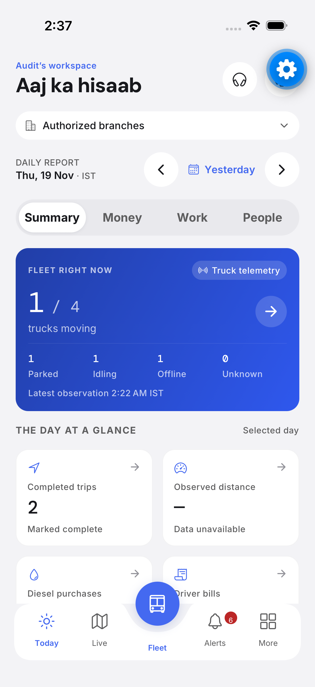</a>

03-owner-more.png — I14 — Owner promise, trip-cost closure and declaration-policy screens absent

**Context:** I14 — Owner promise, trip-cost closure and declaration-policy screens absent

04-issue-owner-capture-queue.png — OWNER / Capture queue — FAIL - HTTP 426; I02 — Owner review uses the Driver capture endpoint

**Context:** OWNER / Capture queue — FAIL - HTTP 426; I02 — Owner review uses the Driver capture endpoint

06-issue-push-unavailable.png — OWNER / Notification registration — LIMITATION - simulator/native push unavailable

**Context:** OWNER / Notification registration — LIMITATION - simulator/native push unavailable

08-issue-manager-426.png — MANAGER / Action cards — FAIL - HTTP 426; I01 — App/backend version mismatch blocks v2 screens; I12 — Manager action details do not implement planned actions

**Context:** MANAGER / Action cards — FAIL - HTTP 426; I01 — App/backend version mismatch blocks v2 screens; I12 — Manager action details do not implement planned actions

12-driver-trips.png — DRIVER / Trip list — PASS - seeded journeys visible

**Context:** DRIVER / Trip list — PASS - seeded journeys visible

<a href="screenshots/12-driver-trips.png">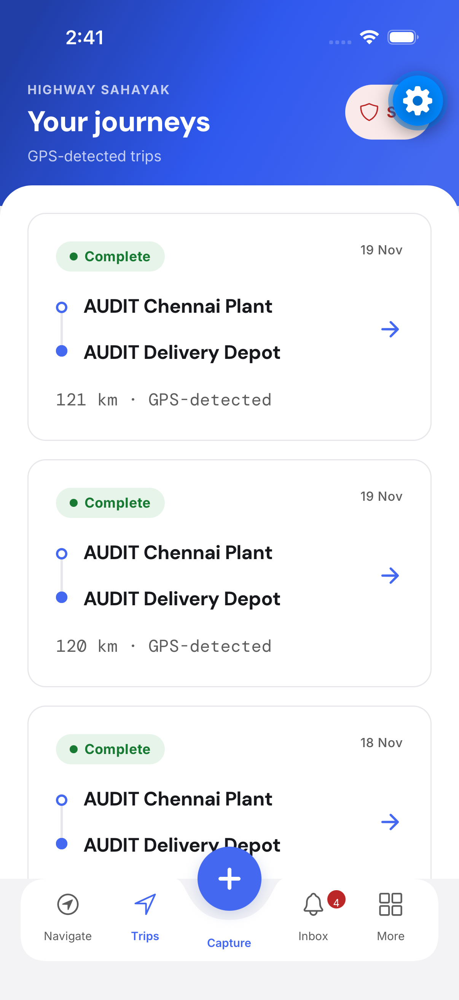</a>

13-driver-inbox.png — DRIVER / Inbox — PASS - seeded alerts/unread visible

**Context:** DRIVER / Inbox — PASS - seeded alerts/unread visible

<a href="screenshots/13-driver-inbox.png">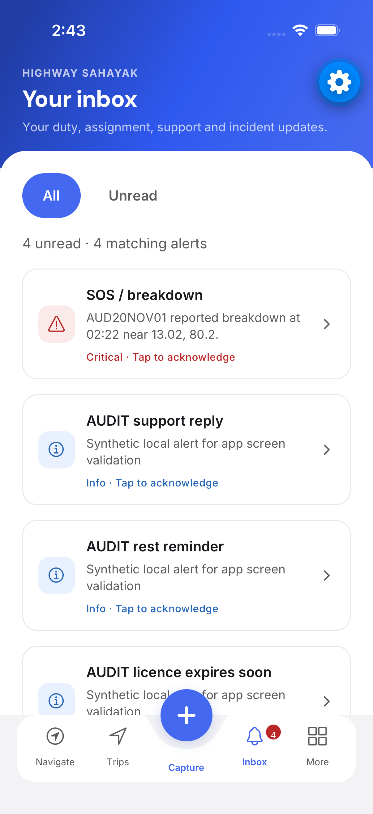</a>

14-issue-driver-crew.png — DRIVER / Crew — FAIL - HTTP 426; I03 — Crew URLs, payload and response shapes disagree

**Context:** DRIVER / Crew — FAIL - HTTP 426; I03 — Crew URLs, payload and response shapes disagree

15-driver-trip-detail.png — DRIVER / Trip detail — PASS - seeded trip/fuel detail visible

**Context:** DRIVER / Trip detail — PASS - seeded trip/fuel detail visible

<a href="screenshots/15-driver-trip-detail.png">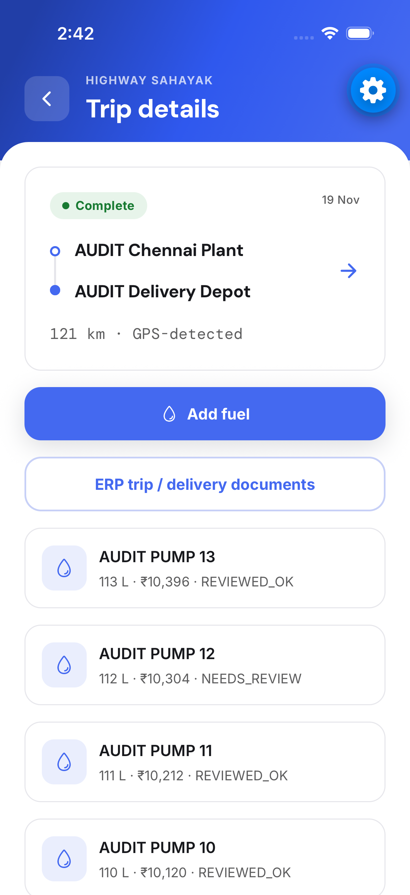</a>

17-driver-documents.png — DRIVER / Personal documents — PASS - two personal records visible

**Context:** DRIVER / Personal documents — PASS - two personal records visible

<a href="screenshots/17-driver-documents.png">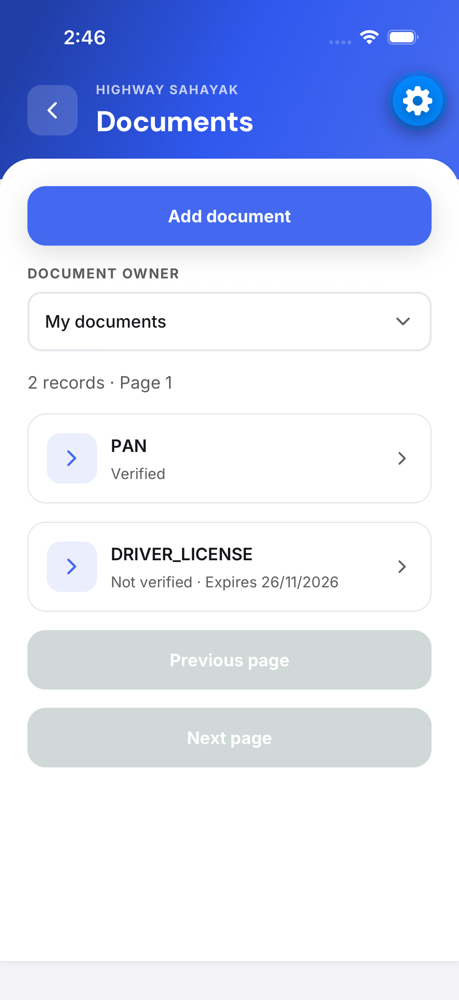</a>

18-driver-help.png — DRIVER / Help — FAIL - HTTP 426; I05 — Help response fails contract for alert dates

**Context:** DRIVER / Help — FAIL - HTTP 426; I05 — Help response fails contract for alert dates

21-issue-navigation-unavailable.png — DRIVER / Navigate — PLACEHOLDER - navigation unavailable; I10 — Navigate and driving journey are not implemented

**Context:** DRIVER / Navigate — PLACEHOLDER - navigation unavailable; I10 — Navigate and driving journey are not implemented

22-driver-capture-menu.png — DRIVER / Capture menu — PARTIAL - working menu; planned tools missing; I11 — Wallet, reimbursement and advances are inactive; I13 — Registered services lack normal menu paths

**Context:** DRIVER / Capture menu — PARTIAL - working menu; planned tools missing; I11 — Wallet, reimbursement and advances are inactive; I13 — Registered services lack normal menu paths

23-agent-initial.png — FIELD_AGENT / Empty-organisation Home — PASS - correct empty organisation context

**Context:** FIELD_AGENT / Empty-organisation Home — PASS - correct empty organisation context

<a href="screenshots/23-agent-initial.png">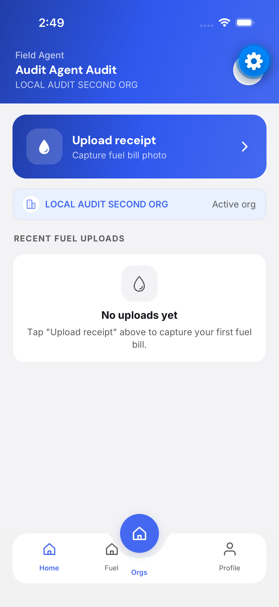</a>

26-issue-agent-org-crash.png — FIELD_AGENT / Organisation selector — FAIL - null data render crash; I06 — Field Agent organisation selector crashes on load

**Context:** FIELD_AGENT / Organisation selector — FAIL - null data render crash; I06 — Field Agent organisation selector crashes on load

27-agent-fuel-history.png — FIELD_AGENT / Fuel log empty state — FAIL - hard-coded August/Improving claims; I09 — Fuel log makes hard-coded period/trend claims

**Context:** FIELD_AGENT / Fuel log empty state — FAIL - hard-coded August/Improving claims; I09 — Fuel log makes hard-coded period/trend claims

28-agent-vehicle-picker.png — FIELD_AGENT / Vehicle picker empty state — PASS - no trucks in secondary organisation

**Context:** FIELD_AGENT / Vehicle picker empty state — PASS - no trucks in secondary organisation

<a href="screenshots/28-agent-vehicle-picker.png">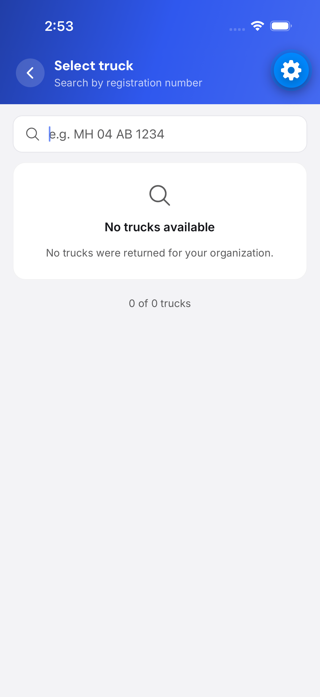</a>

29-agent-primary-home.png — FIELD_AGENT / Home with seeded records — PASS - populated audit organisation

**Context:** FIELD_AGENT / Home with seeded records — PASS - populated audit organisation

<a href="screenshots/29-agent-primary-home.png">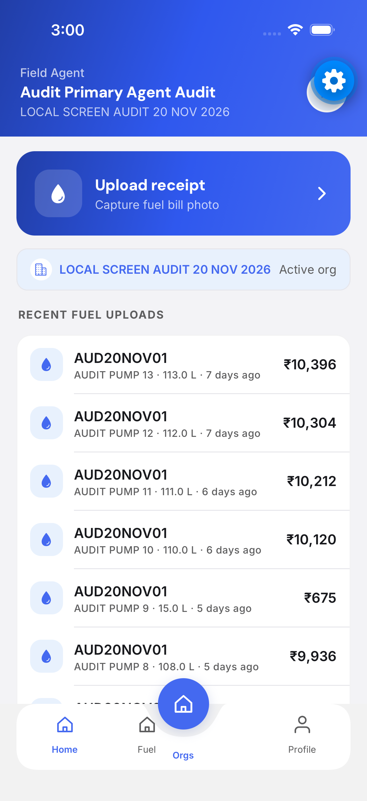</a>

30-agent-primary-vehicles.png — FIELD_AGENT / Populated truck picker — PASS - four audit trucks selectable

**Context:** FIELD_AGENT / Populated truck picker — PASS - four audit trucks selectable

<a href="screenshots/30-agent-primary-vehicles.png">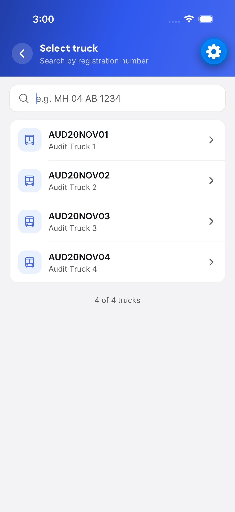</a>

32-issue-agent-logout-org-header.png — FIELD_AGENT / Logout — FAIL - server revocation HTTP 400; I07 — Field Agent server logout is not revoked

**Context:** FIELD_AGENT / Logout — FAIL - server revocation HTTP 400; I07 — Field Agent server logout is not revoked

34-issue-agent-selected-truck-lost.png — FIELD_AGENT / Fuel form — PARTIAL - opens but selected truck dropped; I08 — Chosen truck is dropped by the fuel form

**Context:** FIELD_AGENT / Fuel form — PARTIAL - opens but selected truck dropped; I08 — Chosen truck is dropped by the fuel form

35-agent-populated-fuel-log.png — FIELD_AGENT / Fuel log with records — PARTIAL - records visible; date/trend claims wrong

**Context:** FIELD_AGENT / Fuel log with records — PARTIAL - records visible; date/trend claims wrong

<a href="screenshots/35-agent-populated-fuel-log.png">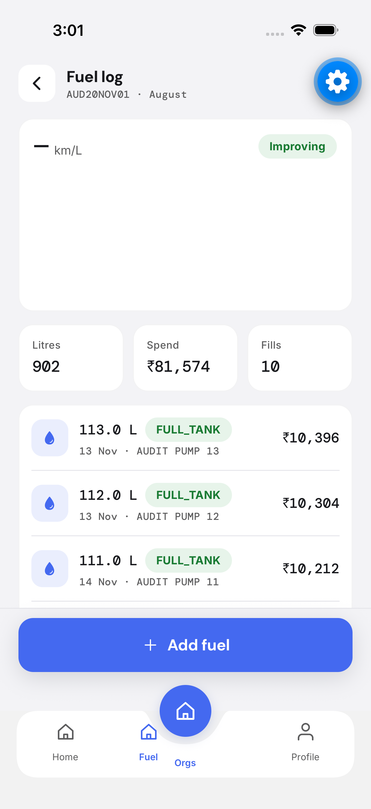</a>

37-owner-live-native.png — OWNER / Native live fleet — PASS - list/map preview opened

**Context:** OWNER / Native live fleet — PASS - list/map preview opened

<a href="screenshots/37-owner-live-native.png">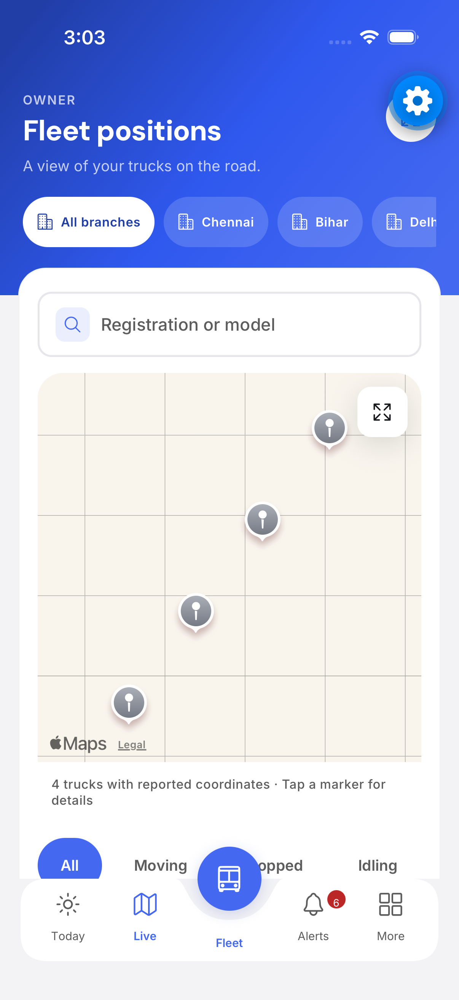</a>

40-owner-full-map.png — OWNER / Native full-screen map — PASS - map exit control verified

**Context:** OWNER / Native full-screen map — PASS - map exit control verified

<a href="screenshots/40-owner-full-map.png">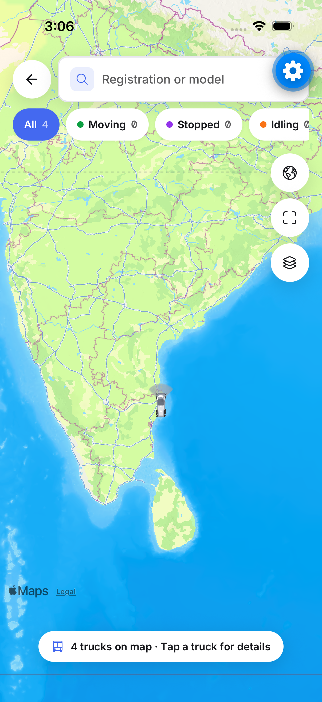</a>

41-owner-final-today.png — OWNER / Final daily report — PASS - refreshed known report fixtures visible

**Context:** OWNER / Final daily report — PASS - refreshed known report fixtures visible

web-driver-add-document-form.png — DRIVER / Add document form — OPENED - deeper behavior unverified

**Context:** DRIVER / Add document form — OPENED - deeper behavior unverified

<a href="screenshots/web-driver-add-document-form.png">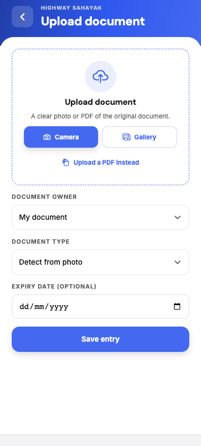</a>

web-driver-add-fuel-form.png — DRIVER / Add fuel form — OPENED - deeper behavior unverified

**Context:** DRIVER / Add fuel form — OPENED - deeper behavior unverified

<a href="screenshots/web-driver-add-fuel-form.png">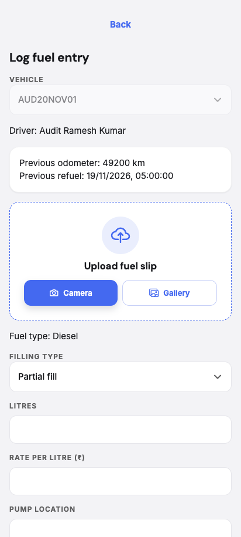</a>

web-driver-add-workshop-bill-form.png — DRIVER / Add workshop bill form — OPENED - deeper behavior unverified

**Context:** DRIVER / Add workshop bill form — OPENED - deeper behavior unverified

<a href="screenshots/web-driver-add-workshop-bill-form.png">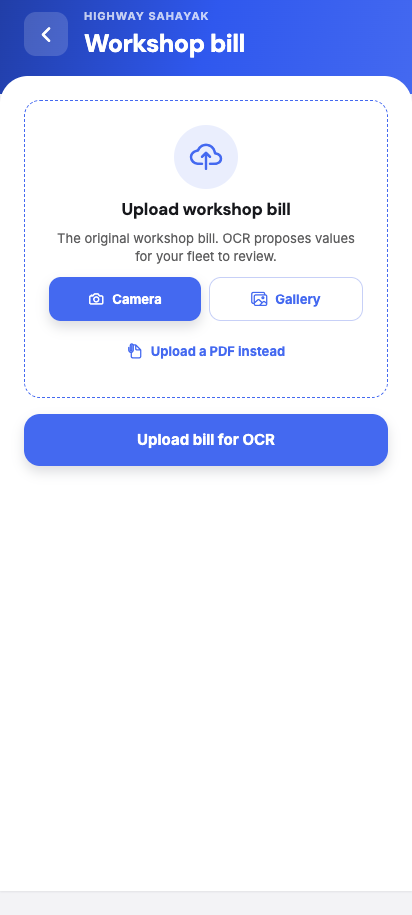</a>

web-driver-conversation.png — DRIVER / Conversation — OPENED - deeper behavior unverified

**Context:** DRIVER / Conversation — OPENED - deeper behavior unverified

<a href="screenshots/web-driver-conversation.png">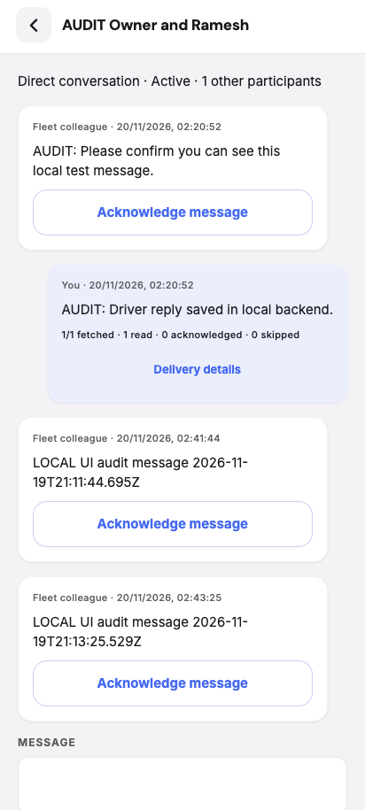</a>

web-driver-crew-driving.png — DRIVER / Crew &amp; driving — FAIL - HTTP 426

**Context:** DRIVER / Crew & driving — FAIL - HTTP 426

<a href="screenshots/web-driver-crew-driving.png">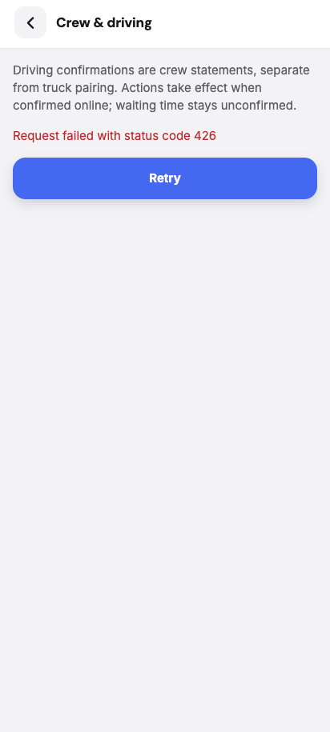</a>

web-driver-documents.png — DRIVER / Documents — OPENED - deeper behavior unverified

**Context:** DRIVER / Documents — OPENED - deeper behavior unverified

<a href="screenshots/web-driver-documents.png">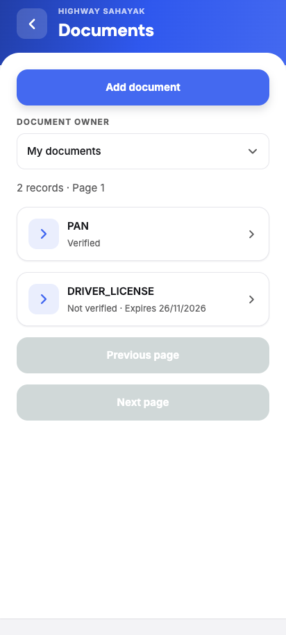</a>

web-driver-driver-help.png — DRIVER / Driver help — FAIL - HTTP 426

**Context:** DRIVER / Driver help — FAIL - HTTP 426

<a href="screenshots/web-driver-driver-help.png">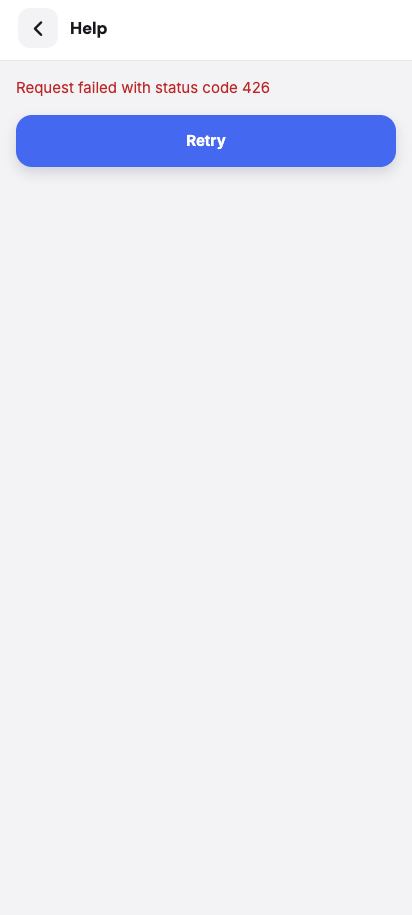</a>

web-driver-erp-trips.png — DRIVER / ERP trips — OPENED - deeper behavior unverified

**Context:** DRIVER / ERP trips — OPENED - deeper behavior unverified

<a href="screenshots/web-driver-erp-trips.png">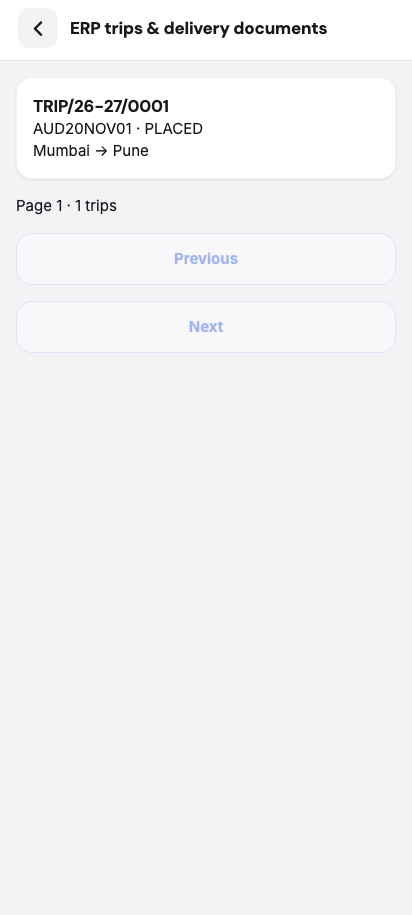</a>

web-driver-experience-settings.png — DRIVER / Experience settings — OPENED - deeper behavior unverified

**Context:** DRIVER / Experience settings — OPENED - deeper behavior unverified

web-driver-fuel-history.png — DRIVER / Fuel history — OPENED - deeper behavior unverified

**Context:** DRIVER / Fuel history — OPENED - deeper behavior unverified

<a href="screenshots/web-driver-fuel-history.png">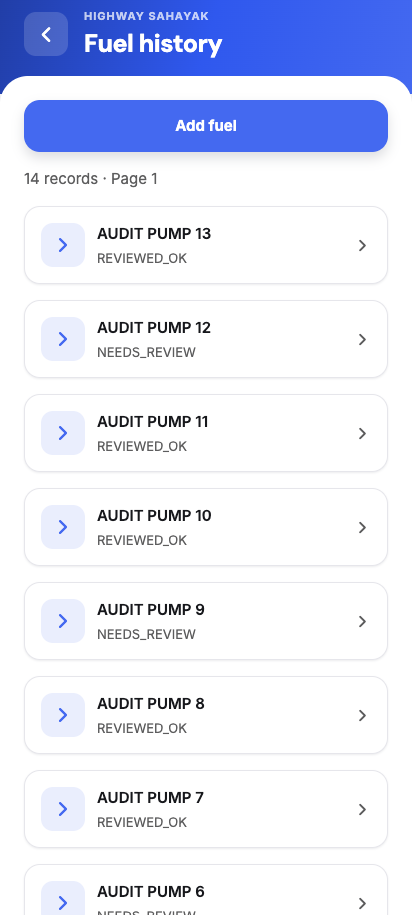</a>

web-driver-initial.png — DRIVER / Initial — PLACEHOLDER - navigation unavailable

**Context:** DRIVER / Initial — PLACEHOLDER - navigation unavailable

<a href="screenshots/web-driver-initial.png">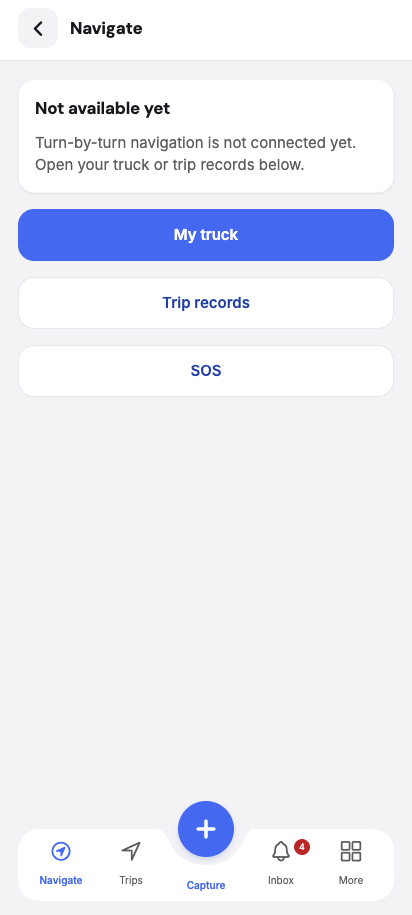</a>

web-driver-issues-after-save.png — DRIVER / Issues after save — OPENED - deeper behavior unverified

**Context:** DRIVER / Issues after save — OPENED - deeper behavior unverified

<a href="screenshots/web-driver-issues-after-save.png">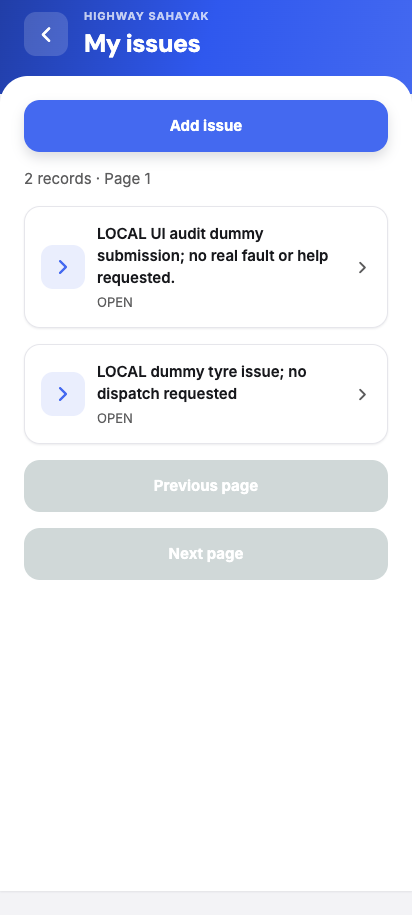</a>

web-driver-location-sharing.png — DRIVER / Location sharing — OPENED - deeper behavior unverified

**Context:** DRIVER / Location sharing — OPENED - deeper behavior unverified

<a href="screenshots/web-driver-location-sharing.png">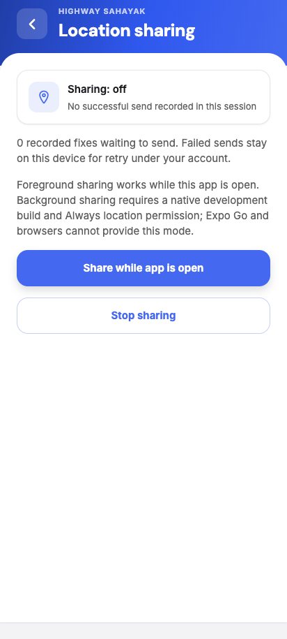</a>

web-driver-messages.png — DRIVER / Messages — OPENED - deeper behavior unverified

**Context:** DRIVER / Messages — OPENED - deeper behavior unverified

<a href="screenshots/web-driver-messages.png">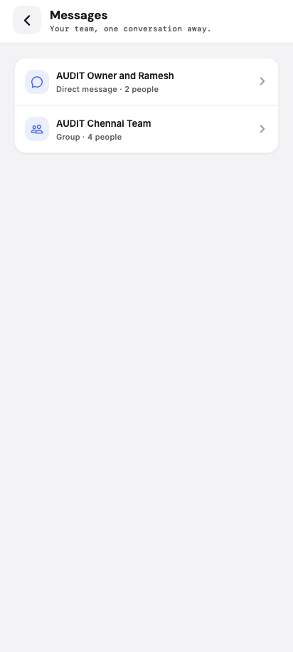</a>

web-driver-my-issues.png — DRIVER / My issues — OPENED - deeper behavior unverified

**Context:** DRIVER / My issues — OPENED - deeper behavior unverified

<a href="screenshots/web-driver-my-issues.png">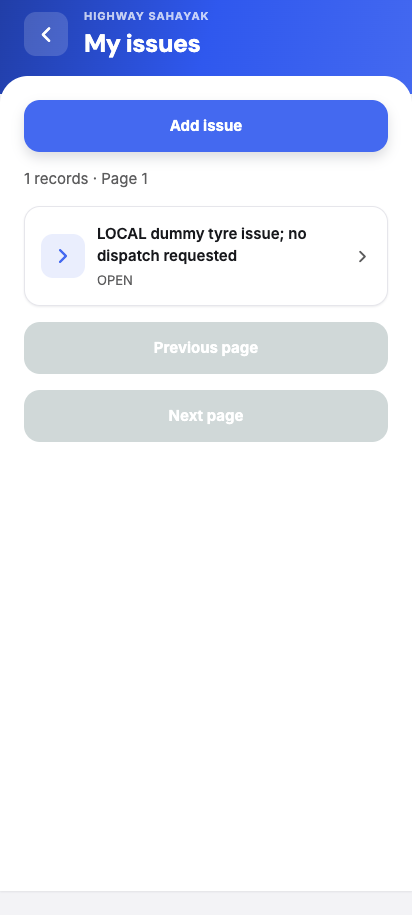</a>

web-driver-my-truck.png — DRIVER / My truck — FAIL - HTTP 426

**Context:** DRIVER / My truck — FAIL - HTTP 426

<a href="screenshots/web-driver-my-truck.png">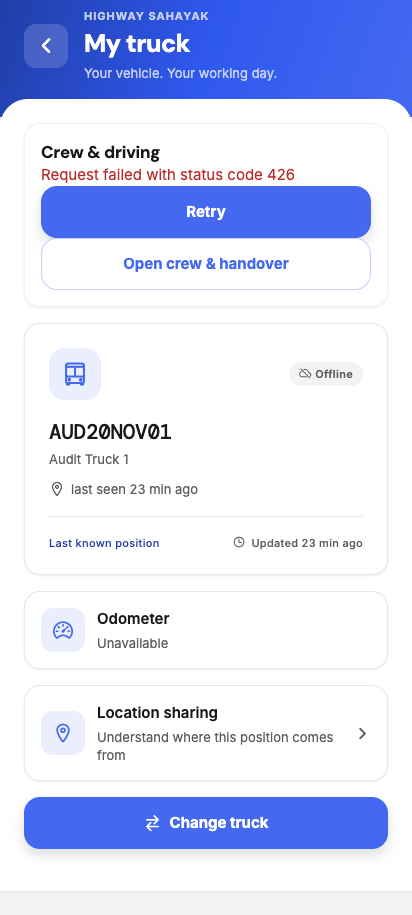</a>

web-driver-new-support-ticket.png — DRIVER / New support ticket — OPENED - deeper behavior unverified

**Context:** DRIVER / New support ticket — OPENED - deeper behavior unverified

<a href="screenshots/web-driver-new-support-ticket.png">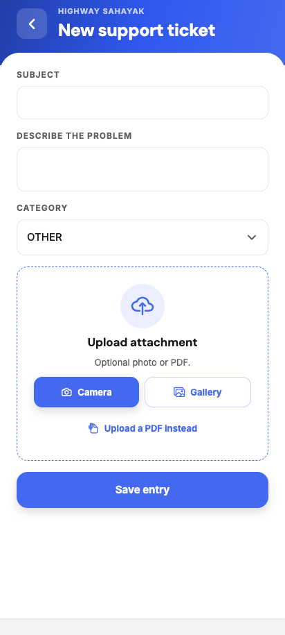</a>

web-driver-new-truck-issue.png — DRIVER / New truck issue — OPENED - deeper behavior unverified

**Context:** DRIVER / New truck issue — OPENED - deeper behavior unverified

<a href="screenshots/web-driver-new-truck-issue.png">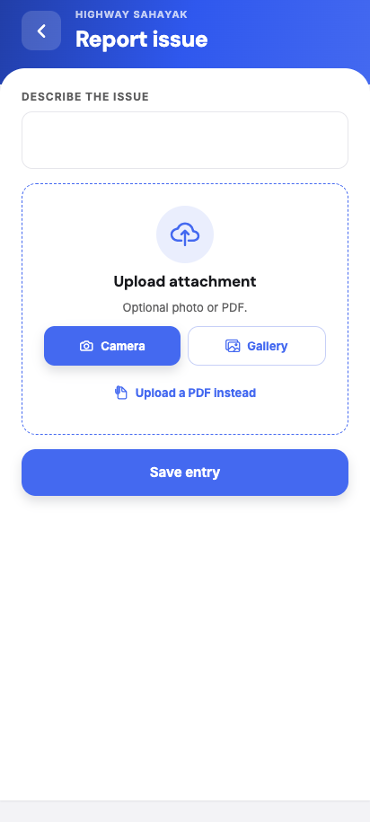</a>

web-driver-profile.png — DRIVER / Profile — OPENED - deeper behavior unverified

**Context:** DRIVER / Profile — OPENED - deeper behavior unverified

<a href="screenshots/web-driver-profile.png">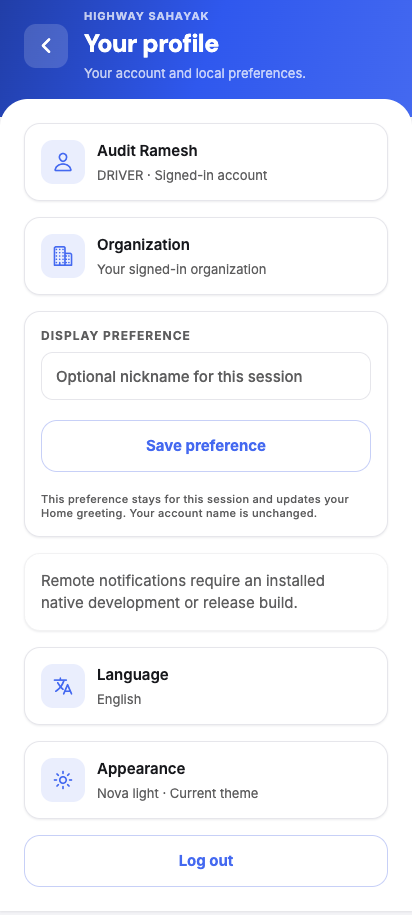</a>

web-driver-save-support-ticket.png — DRIVER / Save support ticket — PASS - UI write and Mongo persistence verified

**Context:** DRIVER / Save support ticket — PASS - UI write and Mongo persistence verified

<a href="screenshots/web-driver-save-support-ticket.png">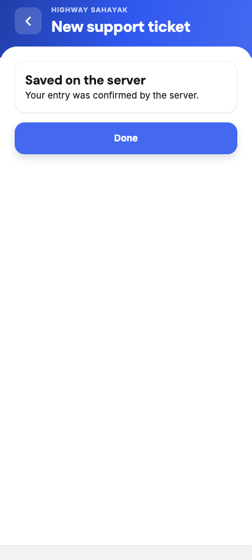</a>

web-driver-save-truck-issue.png — DRIVER / Save truck issue — PASS - UI write and Mongo persistence verified

**Context:** DRIVER / Save truck issue — PASS - UI write and Mongo persistence verified

<a href="screenshots/web-driver-save-truck-issue.png">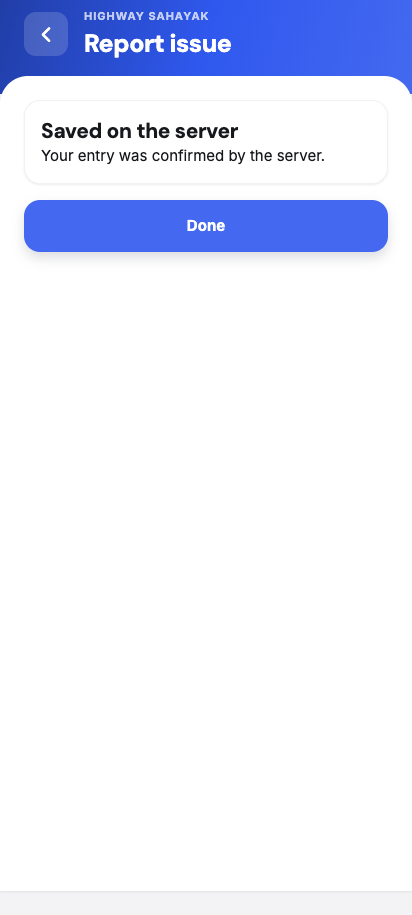</a>

web-driver-support-after-save.png — DRIVER / Support after save — OPENED - deeper behavior unverified

**Context:** DRIVER / Support after save — OPENED - deeper behavior unverified

<a href="screenshots/web-driver-support-after-save.png">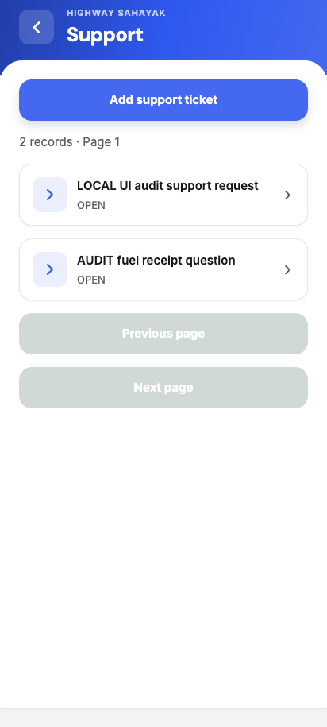</a>

web-driver-support.png — DRIVER / Support — OPENED - deeper behavior unverified

**Context:** DRIVER / Support — OPENED - deeper behavior unverified

<a href="screenshots/web-driver-support.png">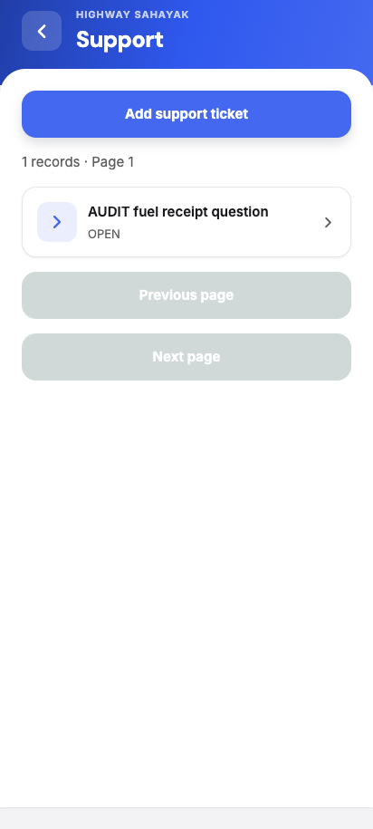</a>

web-driver-tab-inbox.png — DRIVER / Tab Inbox — OPENED - deeper behavior unverified

**Context:** DRIVER / Tab Inbox — OPENED - deeper behavior unverified

<a href="screenshots/web-driver-tab-inbox.png">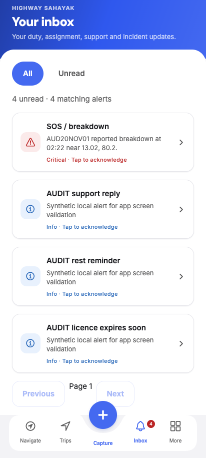</a>

web-driver-tab-more.png — DRIVER / Tab More — OPENED - deeper behavior unverified

**Context:** DRIVER / Tab More — OPENED - deeper behavior unverified

<a href="screenshots/web-driver-tab-more.png">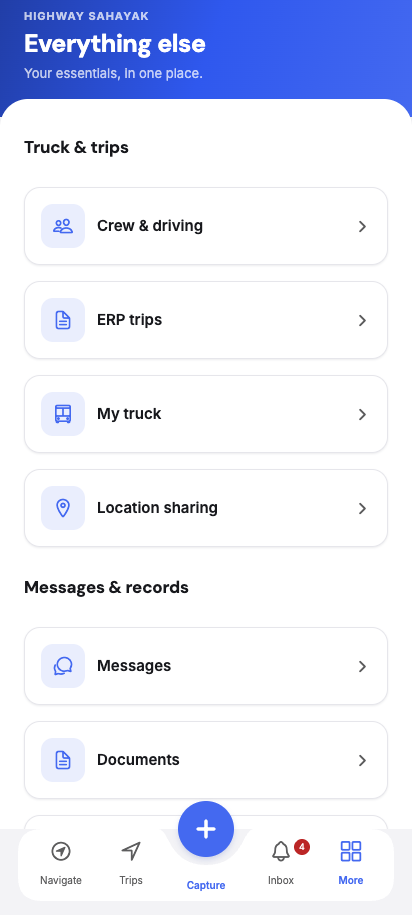</a>

web-driver-tab-trips.png — DRIVER / Tab Trips — OPENED - deeper behavior unverified

**Context:** DRIVER / Tab Trips — OPENED - deeper behavior unverified

<a href="screenshots/web-driver-tab-trips.png">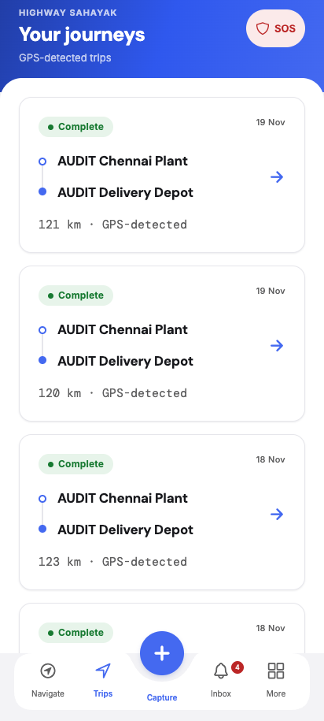</a>

web-driver-workshop-bills.png — DRIVER / Workshop bills — OPENED - deeper behavior unverified

**Context:** DRIVER / Workshop bills — OPENED - deeper behavior unverified

web-manager-adblue-def.png — MANAGER / AdBlue / DEF — OPENED - deeper behavior unverified

**Context:** MANAGER / AdBlue / DEF — OPENED - deeper behavior unverified

web-manager-crew-driving.png — MANAGER / Crew &amp; driving — OPENED - deeper behavior unverified

**Context:** MANAGER / Crew & driving — OPENED - deeper behavior unverified

web-manager-duty-board.png — MANAGER / Duty board — OPENED - deeper behavior unverified

**Context:** MANAGER / Duty board — OPENED - deeper behavior unverified

web-manager-fleet-documents.png — MANAGER / Fleet documents — OPENED - deeper behavior unverified

**Context:** MANAGER / Fleet documents — OPENED - deeper behavior unverified

web-manager-fleet-trips.png — MANAGER / Fleet trips — OPENED - deeper behavior unverified

**Context:** MANAGER / Fleet trips — OPENED - deeper behavior unverified

web-manager-fleet.png — MANAGER / Fleet — OPENED - deeper behavior unverified

**Context:** MANAGER / Fleet — OPENED - deeper behavior unverified

web-manager-fuel-review.png — MANAGER / Fuel review — OPENED - deeper behavior unverified

**Context:** MANAGER / Fuel review — OPENED - deeper behavior unverified

web-manager-initial.png — MANAGER / Initial — FAIL - HTTP 426

**Context:** MANAGER / Initial — FAIL - HTTP 426

web-manager-language-voice.png — MANAGER / Language &amp; voice — OPENED - deeper behavior unverified

**Context:** MANAGER / Language & voice — OPENED - deeper behavior unverified

web-manager-maintenance.png — MANAGER / Maintenance — OPENED - deeper behavior unverified

**Context:** MANAGER / Maintenance — OPENED - deeper behavior unverified

web-manager-messages-broadcasts.png — MANAGER / Messages &amp; broadcasts — OPENED - deeper behavior unverified

**Context:** MANAGER / Messages & broadcasts — OPENED - deeper behavior unverified

web-manager-settings-support.png — MANAGER / Settings &amp; support — OPENED - deeper behavior unverified

**Context:** MANAGER / Settings & support — OPENED - deeper behavior unverified

web-manager-tab-alerts.png — MANAGER / Tab Alerts — OPENED - deeper behavior unverified

**Context:** MANAGER / Tab Alerts — OPENED - deeper behavior unverified

web-manager-tab-drivers.png — MANAGER / Tab Drivers — OPENED - deeper behavior unverified

**Context:** MANAGER / Tab Drivers — OPENED - deeper behavior unverified

web-manager-tab-live.png — MANAGER / Tab Live — OPENED - deeper behavior unverified

**Context:** MANAGER / Tab Live — OPENED - deeper behavior unverified

web-manager-tab-more.png — MANAGER / Tab More — OPENED - deeper behavior unverified; I17 — Manager branch daily report absent

**Context:** MANAGER / Tab More — OPENED - deeper behavior unverified; I17 — Manager branch daily report absent

web-manager-team-access.png — MANAGER / Team &amp; access — OPENED - deeper behavior unverified

**Context:** MANAGER / Team & access — OPENED - deeper behavior unverified

web-owner-billing-cash-flow.png — OWNER / Billing &amp; cash flow — OPENED - deeper behavior unverified

**Context:** OWNER / Billing & cash flow — OPENED - deeper behavior unverified

web-owner-calls-follow-ups.png — OWNER / Calls &amp; follow-ups — OPENED - deeper behavior unverified

**Context:** OWNER / Calls & follow-ups — OPENED - deeper behavior unverified

web-owner-capture-reviews.png — OWNER / Capture reviews — FAIL - HTTP 426

**Context:** OWNER / Capture reviews — FAIL - HTTP 426

web-owner-conversation.png — OWNER / Conversation — OPENED - deeper behavior unverified

**Context:** OWNER / Conversation — OPENED - deeper behavior unverified

web-owner-crew-driving.png — OWNER / Crew &amp; driving — OPENED - deeper behavior unverified

**Context:** OWNER / Crew & driving — OPENED - deeper behavior unverified

web-owner-driver-roster.png — OWNER / Driver roster — OPENED - deeper behavior unverified

**Context:** OWNER / Driver roster — OPENED - deeper behavior unverified

web-owner-escalation-detail.png — OWNER / Escalation detail — OPENED - deeper behavior unverified

**Context:** OWNER / Escalation detail — OPENED - deeper behavior unverified

web-owner-fleet-documents.png — OWNER / Fleet documents — OPENED - deeper behavior unverified

**Context:** OWNER / Fleet documents — OPENED - deeper behavior unverified

web-owner-fleet-home-summary.png — OWNER / Fleet home summary — OPENED - deeper behavior unverified

**Context:** OWNER / Fleet home summary — OPENED - deeper behavior unverified

web-owner-fuel-adblue.png — OWNER / Fuel &amp; AdBlue — OPENED - deeper behavior unverified

**Context:** OWNER / Fuel & AdBlue — OPENED - deeper behavior unverified

web-owner-initial.png — OWNER / Initial — OPENED - deeper behavior unverified

**Context:** OWNER / Initial — OPENED - deeper behavior unverified

web-owner-language-voice.png — OWNER / Language &amp; voice — OPENED - deeper behavior unverified; I16 — Data saver, simple mode and survey preferences missing

**Context:** OWNER / Language & voice — OPENED - deeper behavior unverified; I16 — Data saver, simple mode and survey preferences missing

web-owner-maintenance.png — OWNER / Maintenance — OPENED - deeper behavior unverified

**Context:** OWNER / Maintenance — OPENED - deeper behavior unverified

web-owner-messages-broadcasts.png — OWNER / Messages &amp; broadcasts — OPENED - deeper behavior unverified

**Context:** OWNER / Messages & broadcasts — OPENED - deeper behavior unverified

web-owner-morning-report.png — OWNER / Morning report — OPENED - deeper behavior unverified; I19 — Report delivery/audience/provider settings incomplete

**Context:** OWNER / Morning report — OPENED - deeper behavior unverified; I19 — Report delivery/audience/provider settings incomplete

web-owner-owner-inbox.png — OWNER / Owner inbox — OPENED - deeper behavior unverified

**Context:** OWNER / Owner inbox — OPENED - deeper behavior unverified

web-owner-record-explanation.png — OWNER / Record explanation — PASS - UI write and Mongo persistence verified

**Context:** OWNER / Record explanation — PASS - UI write and Mongo persistence verified

web-owner-reports-trends.png — OWNER / Reports &amp; trends — OPENED - deeper behavior unverified

**Context:** OWNER / Reports & trends — OPENED - deeper behavior unverified

web-owner-save-report-preference.png — OWNER / Save report preference — PASS - UI write and Mongo persistence verified

**Context:** OWNER / Save report preference — PASS - UI write and Mongo persistence verified

web-owner-send-message.png — OWNER / Send message — PASS - UI write and Mongo persistence verified

**Context:** OWNER / Send message — PASS - UI write and Mongo persistence verified

web-owner-settings-support.png — OWNER / Settings &amp; support — OPENED - deeper behavior unverified

**Context:** OWNER / Settings & support — OPENED - deeper behavior unverified

web-owner-tab-alerts.png — OWNER / Tab Alerts — OPENED - deeper behavior unverified

**Context:** OWNER / Tab Alerts — OPENED - deeper behavior unverified

web-owner-tab-fleet.png — OWNER / Tab Fleet — OPENED - deeper behavior unverified

**Context:** OWNER / Tab Fleet — OPENED - deeper behavior unverified

web-owner-tab-live.png — OWNER / Tab Live — OPENED - deeper behavior unverified

**Context:** OWNER / Tab Live — OPENED - deeper behavior unverified

web-owner-tab-more.png — OWNER / Tab More — OPENED - deeper behavior unverified

**Context:** OWNER / Tab More — OPENED - deeper behavior unverified

web-owner-team-access.png — OWNER / Team &amp; access — OPENED - deeper behavior unverified

**Context:** OWNER / Team & access — OPENED - deeper behavior unverified

web-owner-today-s-business-report.png — OWNER / Today&#x27;s business report — PARTIAL - report opens without visible exit; I15 — Legacy report entry has no visible exit

**Context:** OWNER / Today's business report — PARTIAL - report opens without visible exit; I15 — Legacy report entry has no visible exit

web-owner-trip-history.png — OWNER / Trip history — OPENED - deeper behavior unverified

**Context:** OWNER / Trip history — OPENED - deeper behavior unverified

### Additional and intermediate original captures

These 20 files were not part of Excel’s selected evidence gallery. They include login/system prompts, early frames, the Expo developer menu and preview captures. Filenames alone are not proof that the intended screen finished opening.

00-local-login.png — supplemental capture

Local login/setup capture.

01-login-current.png — supplemental capture

Owner login/report with a system password-save prompt; the prompt is not a product defect.

05-owner-notifications.png — supplemental capture

Supplemental/intermediate capture. For completion claims use the labelled runtime observations and selected evidence above.

07-manager-home.png — supplemental capture

Supplemental/intermediate capture. For completion claims use the labelled runtime observations and selected evidence above.

09-manager-live.png — supplemental capture

Early capture still showing Manager Home; do not treat it as a passed Live-screen observation.

10-manager-crew.png — supplemental capture

Supplemental/intermediate capture. For completion claims use the labelled runtime observations and selected evidence above.

11-driver-navigate.png — supplemental capture

Supplemental/intermediate capture. For completion claims use the labelled runtime observations and selected evidence above.

16-driver-my-truck.png — supplemental capture

Supplemental/intermediate capture. For completion claims use the labelled runtime observations and selected evidence above.

19-driver-document-detail.png — supplemental capture

Supplemental/intermediate capture. For completion claims use the labelled runtime observations and selected evidence above.

20-driver-document-form.png — supplemental capture

Supplemental/intermediate capture. For completion claims use the labelled runtime observations and selected evidence above.

24-agent-org-selector.png — supplemental capture

Intermediate capture around opening Orgs; the settled render crash is documented in I06 / 26-issue-agent-org-crash.png.

31-agent-fuel-capture.png — supplemental capture

Supplemental/intermediate capture. For completion claims use the labelled runtime observations and selected evidence above.

33-agent-after-dismiss.png — supplemental capture

Login state after dismissing a development error overlay.

36-owner-final-report.png — supplemental capture

Supplemental Owner report capture before the final settled workspace.

38-owner-map-native.png — supplemental capture

Intermediate map-opening attempt; Expo developer control may obscure the intended app target.

39-owner-map-settled.png — supplemental capture

Expo developer menu over the Live view, not a successful full-screen map capture. The verified map is 40-owner-full-map.png.

42-owner-left-ready.png — supplemental capture

Owner workspace left ready after the audit.

live-current.png — supplemental capture

Preview capture; no additional independent assertion.

live-next.png — supplemental capture

Preview capture; no additional independent assertion.

web-boot-diagnostic.png — supplemental capture

Browser startup diagnostic; no screen-completion claim.

## Files and reproducibility

- [Public Excel workbook](DriverApp_Screen_Runtime_Audit_2026-11-20.xlsx) — all 12 worksheets, 191 plan rows and embedded images.
- [All original screenshots](screenshots/) — 117 files, unchanged.
- [Screen matrix CSV](evidence/screen-matrix.csv) / [JSON](evidence/screen-matrix.json).
- [Runtime observations](evidence/runtime-checks.json).
- [Issue register](evidence/issues.json).
- [API check table](evidence/api-checks.csv).
- [Report reconciliation](evidence/report-reconciliation.json).
- [Saved actions and seed counts](evidence/db-verification.json).
- [Workbook validation](evidence/report-validation.json).

The public Excel retains the screen matrix, results and all 114 embedded images. Account identifiers/passwords in Local Test Accounts are redacted for public upload; your original unredacted Excel remains in the local audit folder. Raw bearer tokens, browser storage states, environment secrets and login-response payloads are not published. Some original Excel source/raw-log references are local-workspace paths; use the portable evidence tables here when browsing GitHub. Internal Excel screenshot links remain usable inside the workbook, and original image links resolve after downloading this audit folder.
